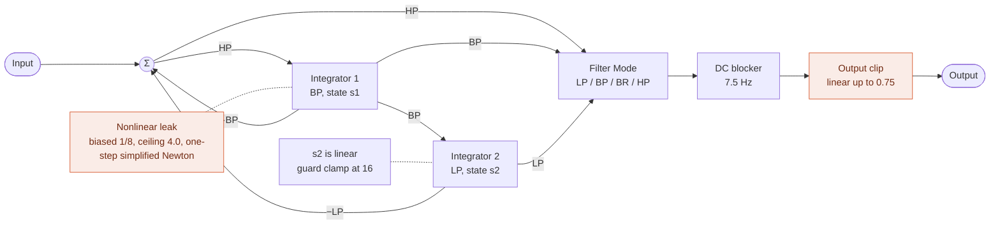
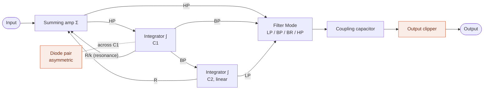
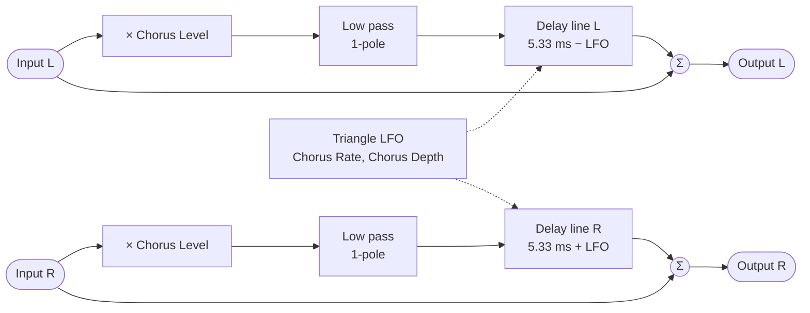
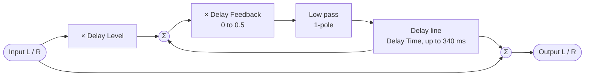
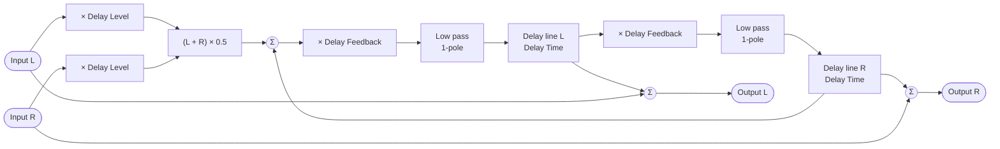
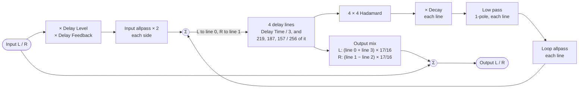
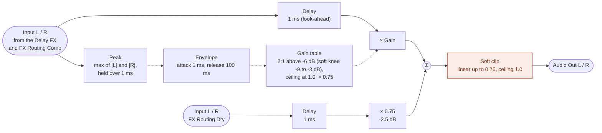

# Digital Synth PRA32-U2 Block Diagrams v3.16.0

- 2026-10-16 ISGK Instruments
- <https://github.com/risgk/digital-synth-pra32-u2>

The diagrams of the Filter, the FX (Chorus FX, Delay FX, and Reverb), and the Output Compressor, and the graphs of the Wave Tables.
For the whole synthesizer, see [Synthesizer Block Diagram](./README.md#synthesizer-block-diagram) in README.md.
Solid arrows carry audio, dashed arrows carry control.

## Filter

A zero-delay feedback state variable filter. The band pass integrator leaks, more and more as
the band pass bends into a soft clip curve (ceiling 4.0), and that is what holds the resonance
down; at small levels the leak is next to nothing, so the pass band passes nearly clean. The
loop equation, leak included, is solved every sample by the one-step simplified Newton method
(the chord method, with the slope held at the linear part) from the linear solution,
which needs no division and lands close to the root. The leak's rate is fixed in time, so the sound
does not change with the sampling rate. The low pass state stays linear, with a clamp at 16 as
a guard that ordinary use never reaches. The curve is biased by 1/8, so that the leak adds even
harmonics as the band pass is driven (at a high Resonance or near the cutoff), with its
small-signal gain made up for, so that the resonance is kept; a DC blocker on the output
removes the DC that comes with it. The output clip comes last. Above the Filter
Resonance 122, k turns negative and the loop oscillates.

The same structure redrawn as an op-amp integrator filter. The asymmetric diode pair stands for
the biased nonlinear leak, the coupling capacitor for the DC blocker, and the output clipper for the
output clip. It is an interpretation, not a reproduction of an actual circuit.

## Chorus FX

A stereo chorus, used as a send effect: the input is sent at the Chorus Level, and the
chorused signal is added to the input. Each side goes through a gentle low pass filter into a
short delay line of its own. A triangle LFO swings the two delay times in opposite directions
about 5.33 ms (by the Chorus Depth, at the Chorus Rate), so the left and right delayed signals
bend in pitch against each other, and a mono source comes out spread across the stereo field.

The delay lines are read between two samples (linear interpolation), and the delay times are
interpolated over the samples between the control updates, so that the pitch bends smoothly.

## Delay FX

A stereo delay with feedback (Delay Mode: Stereo Delay or Ping Pong Delay), used as a send
effect: the input is sent at the Delay Level, and the delayed signal is added to the input.
The send joins the delayed signal, and the sum goes through the Delay Feedback gain and a gentle
low pass filter into the delay line, so the first echo comes at the Delay Level times the Delay
Feedback, and each echo after it at the Delay Feedback times the one before.

### Stereo Delay

Each side has a delay line and a loop of its own. The diagram is one side; the other is the same.

### Ping Pong Delay

The two sides are sent together, as mono, into the left delay line, which feeds the right one,
which feeds the left one again, so the echoes go back and forth between the left and the right.

The delay lines are read between two samples (linear interpolation). When the Delay Time is
changed, the read position follows it at a limited speed, which bends the pitch of the echoes
(within +/-25%), as on a tape delay.

## Reverb

A feedback delay network (FDN) reverb (Delay Mode: Reverb), which reuses the delay lines of the
Delay FX (no extra RAM). It is a send effect as the Delay FX is, and the Delay Level, the Delay
Time, and the Delay Feedback work as they do for the Delay FX: the same values give about the
same length and loudness of the tail.

- It runs at half the sampling rate (24 kHz), every other sample, to halve its processing time:
  the input is the average of two samples, and the output is interpolated between the last two
  results; the lengths above are in 24 kHz samples
- Input diffusion: 2 Schroeder allpasses per side (gain 0.75; 113 and 83 samples for the left, 109
  and 89 for the right), which smear the input so that the tail starts dense; the right side is
  slightly detuned from the left, for decorrelation
- The 4 lines are mixed by an orthonormal Hadamard matrix (additions and subtractions only)
- Size: the line 0 is 1/3 of the Delay Time (the first reflection is a triplet of the delay),
  and the lines 1-3 are 219/256, 187/256, and 157/256 of it; when the Delay Time is changed,
  the lengths follow it slowly (within +/-3% of the pitch), read between two samples
- Decay: each line's gain is set so that the tail falls by the Delay Feedback / 256 over each
  1.5 x Delay Time, so that it sounds about as long as the Delay's echoes
- Damping: a light 1-pole low pass filter in each feedback path, so that the high frequencies
  decay about as fast as the Delay's echoes do
- Loop diffusion: a short allpass (gain 0.5; 73, 89, 107, and 127 samples) in each feedback path, lossless, which multiplies
  the echo density on every pass; the input is added after it, so that the first reflection stays
  in place
- Switching to or from the Reverb, which uses the delay lines differently, fades the wet signal
  out, and clears the delay lines before fading it in again

## Output Compressor

A feed-forward peak compressor for the final output, which also works as the limiter, followed by
the soft clip; always on. The input of FX Routing Dry is not compressed (or limited), but is delayed,
lowered by the output gain, and clipped with the output.

- The peak of both sides is held over the look-ahead time, so that the gain is lowered before the
  peak comes out, and the left and the right are lowered together (the stereo image is kept)
- The gain is looked up in a table, by the envelope in a pseudo-logarithmic scale; it holds the
  soft-knee compression (2:1 above -6 dB at its input, with a soft knee from -9 dB to -3 dB), the
  ceiling (the peaks are limited to 1.0 at its input, reached at +6 dB), and the output gain
  (x 0.75, -2.5 dB)
- The gain is recalculated once per 4 samples, and interpolated over the samples in between

## Wave Table Graphs

