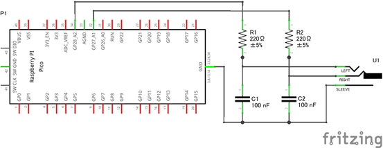
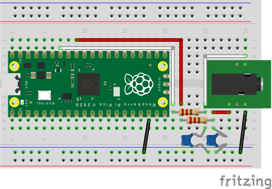

# Digital Synth PRA32-U2 Modification Guide v3.17.5

- 2026-10-26 ISGK Instruments
- <https://github.com/risgk/digital-synth-pra32-u2>
- For modifying PRA32-U2 with Arduino IDE: the MIDI and audio output settings, and the circuit for PWM Audio; see also [README](./README.md)


## Preparation for Modification

- Please install **Arduino IDE**
    - NOTE: Large noise is generated during the sketch upload if other than Update Method: "Default (UF2)" is used
    - Info: <https://www.arduino.cc/en/software>
- Please install Arduino-Pico = **Raspberry Pi Pico/RP2040/RP2350** (by Earle F. Philhower, III) core
    - Additional Board Manager URL: <https://github.com/earlephilhower/arduino-pico/releases/download/global/package_rp2040_index.json>
    - This sketch is tested with version **6.3.0**: <https://github.com/earlephilhower/arduino-pico/releases/tag/6.3.0>
    - Info: <https://github.com/earlephilhower/arduino-pico>
- Please install Arduino **MIDI Library** (by Francois Best, lathoub)
    - This sketch is tested with version **5.0.2**: <https://github.com/FortySevenEffects/arduino_midi_library/releases/tag/5.0.2>
    - Info: <https://github.com/FortySevenEffects/arduino_midi_library>


## Features

### MIDI

#### USB MIDI Device

- NOTE: Select USB Stack: "Adafruit TinyUSB" in the Arduino IDE "Tools" menu
- To disable, comment out `#define PRA32_U2_USE_USB_MIDI` in "Digital-Synth-PRA32-U2.ino"
- MIDI Device Name: "PRA32-U2" ("PRA32-U2/M" for PRA32-U2/M, "PRA32-U2/P" for PRA32-U2/P, and "PRA32-U2/M/P" for PRA32-U2/M/P)


#### UART MIDI

- UART MIDI helps avoid noise caused by USB communication
- To disable, comment out `#define PRA32_U2_USE_UART_MIDI` in "Digital-Synth-PRA32-U2.ino"
- Modify `PRA32_U2_UART_MIDI_SPEED`, `PRA32_U2_UART_MIDI_TX_PIN`, and `PRA32_U2_UART_MIDI_RX_PIN`
    - Speed: 31250 bps (default, for DIN/TRS MIDI) or 38400 bps (for PC)
    - GP4 and GP5 pins are used by UART1 TX and UART1 RX by default
    - You can also use `SerialPIO` (a PIO-based UART on any pins) by making the following changes:

        ```cpp
        #define PRA32_U2_UART_MIDI_TX_PIN              (4)
        #define PRA32_U2_UART_MIDI_RX_PIN              (5)
        SerialPIO mySerial(PRA32_U2_UART_MIDI_TX_PIN, PRA32_U2_UART_MIDI_RX_PIN, 256);  // FIFO: 256 bytes
        #define PRA32_U2_UART_MIDI_SERIAL              mySerial
        ```

        ```cpp
        //  PRA32_U2_UART_MIDI_SERIAL.setTX(PRA32_U2_UART_MIDI_TX_PIN);
        //  PRA32_U2_UART_MIDI_SERIAL.setRX(PRA32_U2_UART_MIDI_RX_PIN);
        //  PRA32_U2_UART_MIDI_SERIAL.setFIFOSize(256);  // To absorb bursts (default: 32 bytes)
        ```

- DIN/TRS MIDI is available by using (and modifying) Adafruit MIDI FeatherWing Kit, for example
    - Adafruit [MIDI FeatherWing Kit](https://www.adafruit.com/product/4740) (Product ID: 4740)
    - M5Stack [Midi Unit with DIN Connector (SAM2695)](https://shop.m5stack.com/products/midi-unit-with-din-connector-sam2695) (SKU: U187) in Separate mode
    - Kinoshita Laboratory [MIDI-UART interface-san Kit](https://www.tindie.com/products/kinoshitalab/midi-uart-interface-san-kit/)
    - 木下研究所 [MIDI-UARTインターフェースさん キット](https://www.switch-science.com/products/8117) (Shipping to Japan only)
    - necobit電子 [MIDI Unit for GROVE](https://necobit.com/denshi/grove-midi-unit/) (Shipping to Japan only)
    - necobit電子 [MIDI Unit Mini for GROVE](https://necobit.com/denshi/midi-unit-mini-for-grove/) (Shipping to Japan only)
- We recommend using [Hairless MIDI<->Serial Bridge](https://projectgus.github.io/hairless-midiserial/) on PC
    - On Windows, we recommend using [loopMIDI](https://www.tobias-erichsen.de/software/loopmidi.html) (virtual loopback MIDI cable)
    - On Mac, a virtual MIDI bus (port) can be created by using the IAC bus


### Audio Output

#### I2S (Default)

- Use an I2S DAC (Texas Instruments PCM5100A, PCM5101A, or PCM5102A is recommended), Sampling Rate: 48 kHz, Bit Depth: 24 bit
    - NOTE: I2S DACs that require MCLK are not supported
- NOTE: The RP2350 system clock (sysclk) changes to overclocked 153.6 MHz, so that the sampling rate is exactly 48 kHz
- PRA32-U2's own PIO I2S Output ("pra32-u2-i2s.h") is used (Arduino-Pico I2S Library is not used)
    - The slot width is 32 bits (BCLK = 64 fs), and the 24-bit samples are sent left-justified
    - BCLK and LRCLK are generated without jitter (the PIO clock divider is an integer)
    - The output buffer is read by DMA without interrupts (lower CPU usage)
- Modify `PRA32_U2_I2S_DAC_MUTE_OFF_PIN`, `PRA32_U2_I2S_DATA_PIN`, `PRA32_U2_I2S_BCLK_PIN`,
  `PRA32_U2_I2S_SWAP_BCLK_AND_LRCLK_PINS`, and `PRA32_U2_I2S_SWAP_LEFT_AND_RIGHT`
  in "Digital-Synth-PRA32-U2.ino" to match the hardware configuration
    - Define `PRA32_U2_I2S_DAC_MUTE_OFF_PIN` and connect this pin to the I2S DAC mute off pin to reduce click noise when writing the parameters to the flash
- The default setting is for Pimoroni [Pico Audio Pack](https://shop.pimoroni.com/products/pico-audio-pack) (PIM544)
    - [Adafruit PCM5102 I2S DAC](https://www.adafruit.com/product/6250) (Product ID: 6250), [Adafruit PCM5100 I2S DAC](https://www.adafruit.com/product/6251) (Product ID: 6251), and GY-PCM5102 (PCM5102A I2S DAC Module) can also be used

    ```
    #define PRA32_U2_I2S_DAC_MUTE_OFF_PIN          (22)
    #define PRA32_U2_I2S_DATA_PIN                  (9)
    #define PRA32_U2_I2S_BCLK_PIN                  (10)  // LRCLK Pin is PRA32_U2_I2S_BCLK_PIN + 1
    #define PRA32_U2_I2S_SWAP_BCLK_AND_LRCLK_PINS  (false)
    #define PRA32_U2_I2S_SWAP_LEFT_AND_RIGHT       (false)
    ```

    - Pico Audio Pack requires no wiring: just plug Raspberry Pi Pico 2 H into it
    - Wiring of Adafruit PCM510x I2S DAC and GY-PCM5102 (the prebuilt UF2 files can be used as they are)

        | Raspberry Pi Pico 2                       | Adafruit PCM510x I2S DAC | GY-PCM5102 |
        | :---------------------------------------- | :----------------------- | :--------- |
        | GP22 (Pin 29) (Optional, Mute Off)        | MU                       | XSMT       |
        | GP9 (Pin 12)                              | DIN                      | DIN        |
        | GP10 (Pin 14)                             | BCK                      | BCK        |
        | GP11 (Pin 15)                             | WSEL                     | LCK        |
        | VBUS (Pin 40) or 3V3(OUT) (Pin 36)        | VIN                      | VIN        |
        | GND                                       | GND                      | GND, SCK   |

    - GY-PCM5102: Recommended settings of the solder jumpers on the back (if not soldered): H1L: L, H2L: L, H3L: H, H4L: L

- The following setting is for [Pimoroni Pico VGA Demo Base](https://shop.pimoroni.com/products/pimoroni-pico-vga-demo-base) (PIM553)

    ```
    //#define PRA32_U2_I2S_DAC_MUTE_OFF_PIN          (0)
    #define PRA32_U2_I2S_DATA_PIN                  (26)
    #define PRA32_U2_I2S_BCLK_PIN                  (27)  // LRCLK Pin is PRA32_U2_I2S_BCLK_PIN + 1
    #define PRA32_U2_I2S_SWAP_BCLK_AND_LRCLK_PINS  (false)
    #define PRA32_U2_I2S_SWAP_LEFT_AND_RIGHT       (false)
    ```

- The following setting is for [Waveshare Pico-Audio](https://www.waveshare.com/wiki/Pico-Audio) Initial Version (WAVESHARE-20167)

    ```
    //#define PRA32_U2_I2S_DAC_MUTE_OFF_PIN          (0)
    #define PRA32_U2_I2S_DATA_PIN                  (26)
    #define PRA32_U2_I2S_BCLK_PIN                  (27)  // LRCLK Pin is PRA32_U2_I2S_BCLK_PIN + 1
    #define PRA32_U2_I2S_SWAP_BCLK_AND_LRCLK_PINS  (false)
    #define PRA32_U2_I2S_SWAP_LEFT_AND_RIGHT       (true)
    ```


#### Audio Buffer

- The size of the output buffer (the maximum output latency) is `PRA32_U2_I2S_BUFFERS` * `PRA32_U2_I2S_BUFFER_WORDS` frames
    - The default is 2 * 64 = 128 frames (2.7 ms)
    - Smaller values reduce the latency, but may cause audio dropouts when the processing of a loop takes longer
- `PRA32_U2_I2S_BUFFER_WORDS` is also the number of frames processed in each loop (the default is 64 frames)
- These settings are also used for PWM Audio
- The latency from receiving a MIDI message to the audio output is about 3.7-5.0 ms (4.3 ms on average) by default (2.7 ms + 0-1.3 ms + 1 ms, below)
    - The output buffer is almost always full, so the frames processed in a loop are output about 2.7 ms after the loop starts
    - The MIDI messages are read once at the start of each loop (every 64 frames, 1.3 ms)
    - The Output Compressor delays the output by 1 ms (look-ahead)
    - The transmission time of the MIDI messages (about 1 ms for 3 bytes with UART MIDI) and the latency of the DAC are not included


#### PWM Audio (Optional)

- PWM Audio can also be used instead of I2S (PWM Audio does not require an I2S DAC hardware)
    - PRA32-U2's own PWM Audio Output ("pra32-u2-pwm-audio.h") is used (Arduino-Pico PWMAudio Library is not used)
    - The PWM level (3200 steps) is quantized with the 1st-order noise shaping and the TPDF dither, which moves the quantization noise to the high frequencies
    - Each sample is output as 4 PWM periods of 800 cycles (PWM carrier: 192 kHz), and the level is split into them (e.g. 801 = 201 + 200 + 200 + 200)
        - The resolution is the same as 1 PWM period of 3200 cycles (48 kHz carrier), but the carrier is easier to filter out
        - This reduces the beeps or whines of some active speakers (especially ones with an ADC/DSP) when the RC filters are omitted
        - Define `PRA32_U2_PWM_AUDIO_SUBPERIODS` as 1, 2, 4 (default), or 8 before including "pra32-u2-pwm-audio.h" to change it (carrier: 48, 96, 192, or 384 kHz)
    - NOTE: Probably smaller output volume than I2S DAC boards
    - The parameters are written to the flash after fading out the output (about 4 ms), and the output is silent while writing (about 50-100 ms)
    - We recommend adding RC filter (post LPF) circuits to reduce the PWM ripples
        - A 1st-order LPF with a cutoff frequency 7.2 kHz (R = 220 ohm, C = 100 nF) works well
        - They also reduce the radio noise (EMI) radiated from the cables carrying the square waves: put them close to the pins
    - Without the RC filters, the PWM ripples (3.3 V square waves) reach the connected device along with the audio,
      and may saturate its input (e.g. of an audio interface) and cause beeps or noises, even when its level meter looks fine
        - Reduce the level with a volume control (e.g. a cable with an inline stereo volume control), resistors, or the input gain (volume) of the connected device
        - Start with the volume turned down: at the top, the full 3.3 V square waves reach the device
    - See "PWM audio" in [Hardware design with RP2040](https://datasheets.raspberrypi.com/rp2040/hardware-design-with-rp2040.pdf)
      for details on PWM audio
- NOTE: The RP2350 system clock (sysclk) changes to overclocked 153.6 MHz (the same as I2S), regardless of CPU Speed in the Arduino IDE "Tools" menu
    - The sample period is exactly 3200 cycles (Sampling Rate: 48 kHz), and the PWM period is 800 cycles (by default)
- Uncomment `//#define PRA32_U2_USE_PWM_AUDIO_INSTEAD_OF_I2S`
  in "Digital-Synth-PRA32-U2.ino" and modify `PRA32_U2_PWM_AUDIO_L_PIN` and `PRA32_U2_PWM_AUDIO_R_PIN`
- The following setting is for Pimoroni Pico VGA Demo Base (PIM553)

    ```
    #define PRA32_U2_PWM_AUDIO_L_PIN               (28)
    #define PRA32_U2_PWM_AUDIO_R_PIN               (27)
    ```


## Simple Circuit for PWM Audio (Optional)

### Circuit Diagram



- This image was created with Fritzing.
    - Actually, it is necessary to use Raspberry Pi Pico 2 (instead of Raspberry Pi Pico)
- The RC filters (R1, R2, C1, and C2) are recommended: see [PWM Audio (Optional)](#pwm-audio-optional)
    - Without them, connect GP28 and GP27 to the audio jack directly (replace R1 and R2 with wires, and remove C1 and C2)
- Adding 10 uF electrolytic capacitors (AC coupling capacitors) will cut the DC components of the audio outputs.
- NOTE: Connect an amplifier or an active speaker to the audio jack.
  Connecting a headphone or a passive speaker may cause a large current to flow and damage the devices.


### Actual Wiring Diagram



- This image was created with Fritzing.
    - Actually, it is necessary to use Raspberry Pi Pico 2 (instead of Raspberry Pi Pico)
- The resistors and the capacitors (the RC filters) are recommended, as in [Circuit Diagram](#circuit-diagram)
