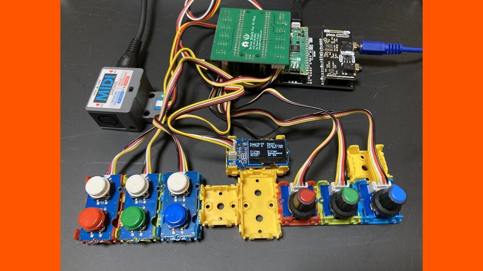
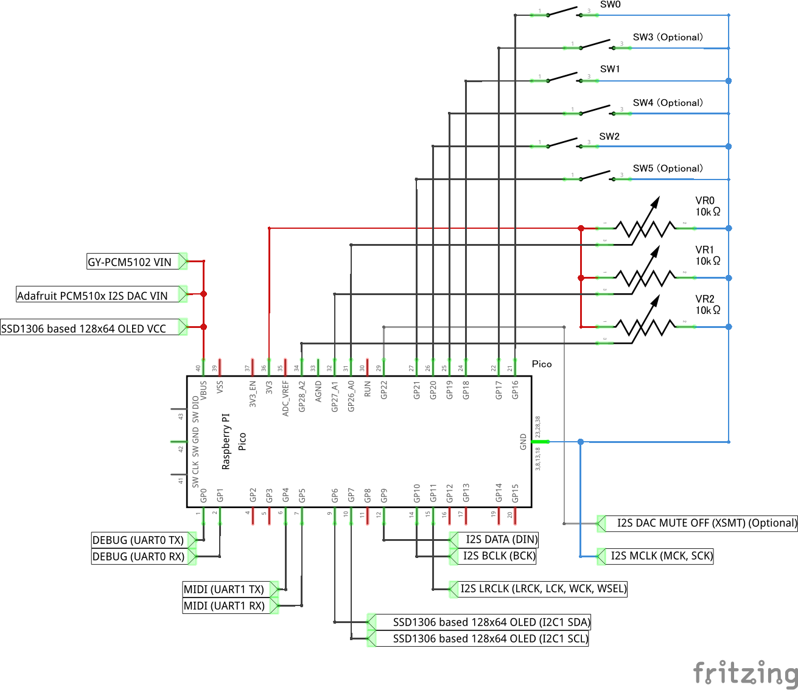
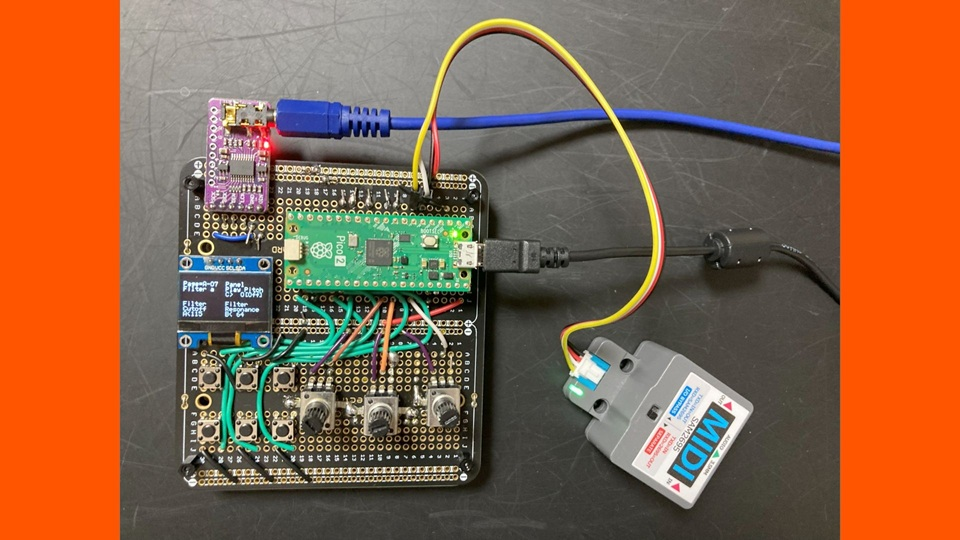
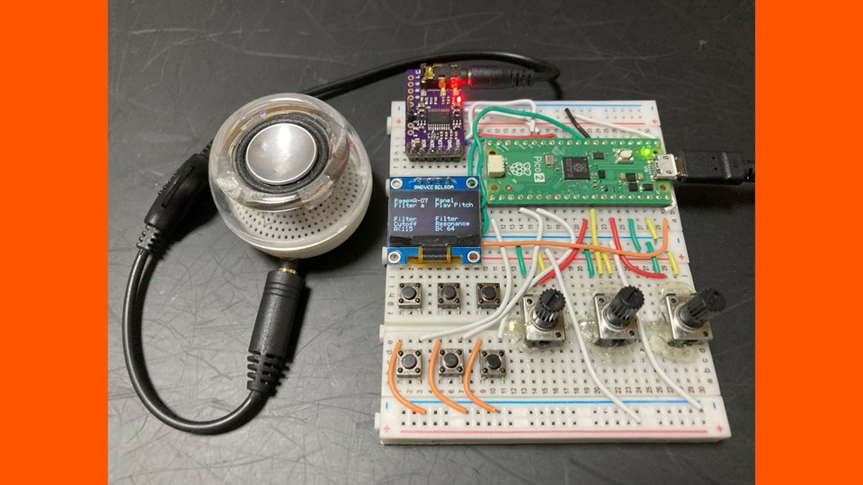

# Digital Synth PRA32-U2/P

- <https://github.com/risgk/digital-synth-pra32-u2>


## PRA32-U2/P (PRA32-U2 with Panel) (Optional)



- Features
    - Editing and displaying parameters by panel operation
    - Playing by panel operation
    - Built-in monophonic 8-step sequencer
    - Panel and Step Sequencer Parameters
    - [Panel Channel](#panel-channel), to control them by MIDI, with the panel or without it ([PRA32-U2/P Headless](#pra32-u2p-headless))
- This option requires 2 to 6 SWs (tactile switches), 2 to 3 VRs (ADCs), and a monochrome 128x64 OLED Display based on SSD1306 series drivers
    - SWs: Prev and Next, and optionally Play, Prog -, Prog +, and Shift (see Inputs)
    - OLED Display: I2C1, SDA: GP6, SCL: GP7, Address: 0x3C (by default)
    - Tested with Pimoroni Pico Audio Pack, M5Stack MIDI Unit (optional), Long Leg 2x20 Pin Socket * 2, Seeed Studio's Grove Shield for Pi Pico, Dual Button * 3, Rotary Angle Sensor * 3, and an OLED Display 0.96 inch
- Uncomment `//#define PRA32_U2_USE_CONTROL_PANEL` in "Digital-Synth-PRA32-U2.ino" and modify the constants
- Inputs
    - SW0: Prev Key (Push to go to the previous page, Long press to the previous group)
    - SW1: Next Key (Push to go to the next page, Long press to the next group)
    - SW2: Play Key (Key Mode: press to play, Step Sequencer Mode: push to start/stop, Key + Seq Mode: press to play) (Removable)
        - Next Key + Play Key: Start/stop the Step Sequencer (Seq Mode and Key + Seq Mode; press the Next Key first)
        - Not to use this key, comment out `#define PRA32_U2_KEY_INPUT_PLAY_KEY_PIN          (20)` in "Digital-Synth-PRA32-U2.ino"
    - SW3: Prog - Key (Long press to change to the previous user program) (optional)
        - To use this key, uncomment `//#define PRA32_U2_KEY_INPUT_PROG_MINUS_KEY_PIN    (17)` in "Digital-Synth-PRA32-U2.ino"
    - SW4: Prog + Key (Long press to change to the next user program) (optional)
        - To use this key, uncomment `//#define PRA32_U2_KEY_INPUT_PROG_PLUS_KEY_PIN     (19)` in "Digital-Synth-PRA32-U2.ino"
        - Prog -/+ Key (PRA32-U2/M/P): On a channel that sets a program for each synth (+ 0, + 1, ...), the program goes by the number of them,
          to the multiple of it, so that the synths stay in the same sets: by 4 on the Layering, "[All]" (#0-3, #4-7, ...; e.g. #5 to #8 or #4), and by 2 on "[Ly2]" and "[RLy]"
            - The program shown ("#") is the last program that the synth took (#0-31, by Program Change from MIDI, the Read pages, or Prog -/+ Key; not #127, Randomize Synth),
              and that of the first synth for a group or the Layering (e.g. #0, #2, and #0 at the start for the Basic Channel + 4, + 5, and + 15 with Ly2)
            - From a Factory Preset (#16-31), Prog + Key goes to #0, and Prog - Key to the last set (e.g. #12 on "[All]")
    - SW5: Shift Key (optional)
        - Shift + Prev/Next Key: Go to the previous/next group without long-pressing
        - Shift + Prog -/+ Key: Change to the previous/next user program without long-pressing
        - Shift + VR0/1/2: Prevent values from changing across 64
        - Shift + Play Key: Panic (All Sound Off and Reset All Controllers of the synth, and of that of the Step Sequencer, as Panic on Page B-24)
        - Shift + Prev Key + Next Key (PRA32-U2/M/P): Go to the previous synth (channel)
        - To use this key, uncomment `//#define PRA32_U2_KEY_INPUT_SHIFT_KEY_PIN         (21)` in "Digital-Synth-PRA32-U2.ino"
    - VR0 (ADC0): Parameter A
    - VR1 (ADC1): Parameter B
    - VR2 (ADC2): Parameter C for Play (Removable)
        - Panel Play Pitch in Key Mode and Key + Seq Mode, Seq Pitch Ofst (Offset) in Step Sequencer Mode
        - Not to use this, comment out `#define PRA32_U2_KEY_INPUT_PLAY_KEY_PIN          (20)` in "Digital-Synth-PRA32-U2.ino"
- NOTE: Using a USB cable with ferrite cores is recommended to prevent ADCs from being affected by USB MIDI communication noise, and UART MIDI control is also recommended


### PRA32-U2/M/P (PRA32-U2 Multi-Timbre Edition with Panel) (Optional)

- Copy all files in the "Digital-Synth-PRA32-U2" folder, except for "Digital-Synth-PRA32-U2.ino", to the "Digital-Synth-PRA32-U2-M" folder
- Uncomment `//#define PRA32_U2_USE_CONTROL_PANEL` in "Digital-Synth-PRA32-U2-M.ino"
- Prev Key + Next Key: Push to go to the next synth (channel), or to the previous one with the Shift Key (Shift + Prev + Next)
    - With the Basic Channel 1 (default): "Ch 1 [Sy0]" -> "Ch 2 [Sy1]" -> "Ch 3 [Sy2]" -> "Ch 4 [Sy3]" -> "Ch 5 [Ly2]" -> "Ch 6 [Ly2]" -> "Ch 16[All]" -> "Ch 1 [Sy0]" (e.g. with Ly2)
    - The MIDI channel (the Basic Channel + 0 to + 3 the synths, + 4 and + 5 by Voice Group Mode, and + 15 the Layering; see [PRA32-U2/M](./README.md#pra32-u2m-pra32-u2-multi-timbre-edition)),
      and what it is: "[Sy0]" the Main Synth, "[Sy1]" to "[Sy3]" the Sub Synths 1-3, Voice Group Mode for + 4 and + 5 (e.g. "[Ly2]" and "[RR3]"), and "[All]" the Layering
    - On the Round Robin and the Layering, the current values (and Write) are those of the first synth of the channel
    - Only a channel that goes to a synth now can be selected: the Main Synth only with Voice Group Mode Off (as only the Basic Channel is used);
      back to the Main Synth when the channel selected goes to none. While the Main Synth is in Poly, a group without it (e.g. "[RR3]") does not play notes
    - The channel selected (Panel Target Ch, CC #58 on the Panel Channel) is a panel parameter: kept by Write Panel Prms (selected again at the start, and by Read Panel Prms)
      and by Store and Export of PRA32-U2 Editor, and back to the Main Synth by Init Panel Prms


### GUI Pages

- The display: the top 2 lines, and the page (e.g. Page A-6 Osc a) with Parameter C on its right (for Play), and Parameter A and B below them

    ```
    #4            S8  *53
    Ch 5 [Ly2] Panel
    Page A-6   Play Pitch
    Osc a      C=...
    ```

    - "#" and the program (the last program that the synth took), with Prog -/+ Key; "S" and the channel of the Step Sequencer (if Seq Ch Ofst is not +0, in Seq and K+S);
      and the step of the Step Sequencer, with "*" while the Play Key plays (see Panel Play Mode)
    - "Ch" and the channel (1-16) that the panel selects (PRA32-U2/P: the Basic Channel), and what it is (PRA32-U2/M/P; see Prev Key + Next Key in PRA32-U2/M/P)

#### Group A

- Synth Parameters
    - NOTE: The parameters Filter EG Amt and EG Filter Amt are the same

#### Group B

- Panel Parameters
    - Panel Play Mode [Key|K+S|Seq]: Key Mode, Key + Seq Mode, Step Sequencer Mode
        - K+S: the Step Sequencer (started and stopped by Next Key + Play Key, Panel Play, or MIDI Start/Stop), and the Play Key that plays
          as in Key Mode (and Panel Key) (e.g. the Step Sequencer on a Sub Synth by Seq Ch Ofst, and the Play Key on the synth that the panel selects)
        - The display shows the step of the Step Sequencer at the right end of the top line, as in Seq Mode, and "*" on its left while the Play Key plays
          (e.g. "*3", or "*53" with Seq Pattern 4x4: the shift 5 and the step 3)
    - Panel Scale [Maj|Min|Mel|MaP|MiP|Chr]: Major, Natural Minor, Ascending Melodic Minor (Jazz Minor), Major Pentatonic, Minor Pentatonic, Chromatic (2 octaves)
    - Panel Pitch Ofst (Offset) [- to +]: Offset Panel Play Pitch and Seq Pitch 0-7 (min -60 to max +60)
        - For example, if Panel Scale is Maj and Panel Pitch Ofst is -25, the scale is G Mixolydian
        - For example, if Panel Scale is Maj and Panel Pitch Ofst is -15, the scale is A Aeolian (Natural Minor)
        - For example, if Panel Scale is Maj and Panel Pitch Ofst is +10, the scale is D Dorian
        - For example, if Panel Scale is Maj and Panel Pitch Ofst is +20, the scale is E Phrygian
        - For example, if Panel Scale is Maj and Panel Pitch Ofst is +25, the scale is F Lydian
    - Panel Transpose [- to +]
        - For example, if Panel Scale is Mel and Panel Transpose is -3, the scale is A Ascending Melodic Minor (Jazz Minor)
        - For example, if Panel Scale is Min and Panel Transpose is -3, the scale is A Natural Minor
        - For example, if Panel Scale is MiP and Panel Transpose is -3, the scale is A Minor Pentatonic
    - Panel Play Pitch: 0 is Off, 1-4 is lowest, 124-127 is highest
    - Panel Play Velo (Velocity)
    - MIDI Basic Ch: Basic Channel 1-16
    - Panel MIDI Tx (Transmit) [Off|Clk|All|Nte|C+N|A+N]: what the panel transmits, by UART MIDI and USB MIDI
        - Off: none, Clk: MIDI Clock (the default), All: MIDI Clock, Start, and Stop,
          Nte: the notes (Note On and Off), C+N: MIDI Clock and the notes, A+N: MIDI Clock, Start, Stop, and the notes
        - MIDI Clock, Start, and Stop: in Seq Mode and K+S (see Seq Clock Src); Start and Stop when the Step Sequencer starts and stops
        - The notes: those that the panel plays (the Play key, the Step Sequencer, Panel Key, and Panel Play), on the channel that the panel selects, as it is
          (e.g. that of a group, without the Round Robin to the Sub Synths)
        - NOTE: A DAW that sends the notes back to PRA32-U2 (e.g. by the monitoring of a track) makes them sound twice
        - Not to transmit by USB MIDI, uncomment `//#define PRA32_U2_DISABLE_USB_MIDI_TRANSMITTION` in "Digital-Synth-PRA32-U2.ino" (or "Digital-Synth-PRA32-U2-M.ino")
- Step Sequencer Parameters
    - Seq Rx St/Sp (Receive Start/Stop): Off, On
    - Seq Ch Ofst (Channel Offset) [+0 to +15]: the channel of the Step Sequencer, as the channel that the panel selects + the offset (mod 16);
      +0 (the default) is the channel that the panel selects, as before
        - The display shows the channel of the Step Sequencer as "S" and the MIDI channel (e.g. "S8"), on the left of the step, if not +0 (in Seq and K+S)
        - A channel that goes to no synth (e.g. +8) plays no synth: with Panel MIDI Tx, the notes go to the device on the channel
    - Seq Step Note [4|8|16]: Quarter Note, Eighth Note, Sixteenth Note
    - Seq Clock Src [Aut|Int|Ext]: Auto (the default), Internal, External (Rx MIDI Clock)
        - Aut: Internal at first, External at a MIDI Clock, and Internal when Seq Tempo is changed (External again at the next MIDI Clock),
          so that the internal clock plays when MIDI Clocks no longer come (e.g. a DAW stopped)
        - In Seq Mode and K+S, MIDI Clocks are sent by UART MIDI and USB MIDI (by Panel MIDI Tx): those of the internal clock, and with Ext (and Aut),
          those received, passed on (e.g. to the next device of a chain)
        - NOTE: Connecting UART MIDI IN and OUT both ways to a device that sends MIDI Clocks back (e.g. one synced to them) may keep the Clocks going round
        - NOTE: With a device that keeps sending MIDI Clocks (e.g. some MIDI keyboards), Aut plays at its tempo: set it to Int to play at Seq Tempo
    - Seq Tempo: 30-240 BPM (in steps of 2 BPM)
    - Seq Gate Time [1/6|2/6|3/6|4/6|5/6|6/6]
    - Seq Direction [Fwd|Rvs|Bnc]: Forward, Reverse, Bounce (Seq Mode before)
    - Seq Num Steps (Number of Steps): 1-32 (current step mod 8 is used as the index for Seq Pitch and Seq Velo; with Seq Pattern 4x4, the length of each shift)
    - Seq Pattern [Std|4x4]: Standard (0-63, the default), 4x4 (64-127)
        - 4x4: Seq Pitch 0-7 and Seq Velo 0-7 as the pattern (0-3) and the shifts (4-7): the pattern is played again and again,
          shifted by Seq Pitch 4, 5, 6, and 7 in turn (each added to the offsets, as Seq Pitch Ofst, -60 to +60), and Seq Velo 4-7 (each added to
          the velocity, 64 as 0; 1-127); Seq Num Steps is the length of each shift (e.g. 8 for the pattern twice)
        - 4x4: Seq On Steps and Seq Act Steps (Step 1-3) work on the pattern; Seq Act Steps (Step 5-7) on the shifts (the shift by Seq Pitch 4 is always Active);
          Seq Direction works on the pattern; Panel Scale, Panel Pitch Ofst, Panel Transpose, Seq Pitch Ofst, and Seq Transpose take effect at each shift;
          Seq Rand Pitch randomizes Seq Pitch 0-3 (the pattern) alone
        - NOTE: The shifts move the pitches of the pattern in the steps of the pitch values (as Panel Pitch Ofst), not by the degrees of the scale:
          a chord of the pattern is not kept (e.g. C, E, G, and C shifted by -30 in Maj are G, A, C, and G)
    - Seq Pitch Ofst (Offset) [- to +]: Offset Seq Pitch 0-7 (min -60 to max +60), added to Panel Pitch Ofst
    - Seq Transpose [- to +]: Transpose Seq Pitch 0-7, added to Panel Transpose (e.g. -12 for the Step Sequencer an octave lower than the Play Key)
    - Seq On Steps: bit 0 is Step 1 On, ..., bit 6 is Step 7 On (Step 0 is always On)
    - Seq Act Steps (Active Steps): bit 0 is Step 1 Active, ..., bit 6 is Step 7 Active (Step 0 is always Active)
    - Seq Pitch 0-7: 0 is Off, 1-4 is lowest, 124-127 is highest
      (with Seq Pattern 4x4, Seq Pitch 4-7 are the shifts, 64 as 0: 0-4 is -60, not Off)
    - Seq Velo 0-7 (Velocity 0-7)
- Step Sequencer Operations
    - Seq Rand Pitch (Randomize Pitch 0-7, or 0-3 with Seq Pattern 4x4): Change the value from 0-31 [Rdy] to 96-127 [Exe]
    - Seq Rand Velo (Randomize Velo 0-7): Change the value from 0-31 [Rdy] to 96-127 [Exe]
- Control Parameters (see [Performance Controllers](./docs/parameter-guide.md#performance-controllers) in the Parameter Guide)
    - Pitch Bend: the MSB only (64 is the center, and 127 is the max, +8191)
    - Modulation Wheel
    - Breath Controller
    - Expression
    - Sustain Pedal
    - Portamento Switch
    - Channel Pressure
- Control Operations
    - Panic: Change the value from 0-31 [Rdy] to 96-127 [Exe]
    - Randomize Synth (Randomize Synth Parameters, as Program Change #127): Change the value from 0-31 [Rdy] to 96-127 [Exe]


#### Group C

- Write Operations
    - Write #0-15 (User), Write Panel Prms (Write Panel and Step Sequencer Parameters)
        - Change the value from 0-31 [Rdy] to 96-127 [Exe] to write to the flash


#### Group D

- Read Operations
    - Read #0-15 (User), #16-31 (Factory Presets), Read Panel Prms, Init Panel Prms
        - Change the value from 0-31 [Rdy] to 96-127 [Exe] to read from the flash
        - Read Panel Prms and Init Panel Prms are for the panel parameters, whatever synth (channel) the panel selects
- Undo Operations (also on Page C-9, after the Write Operations)
    - Undo Write: Brings back the user program (or the panel parameters) in the flash that the last Write replaced
    - Undo Read: Brings back the parameters (or the panel parameters) that the last Read (or Init Panel Prms) replaced
        - Change the value from 0-31 [Rdy] to 96-127 [Exe] to undo; doing it again redoes it
        - Only the last Write and the last Read, of the synth selected then, until the power is turned off


### Panel Channel

- The Control Changes on the Panel Channel (the Basic Channel + 14, 15 by default) control the Panel and Step Sequencer Parameters
  and the operations (Write Panel Prms, Seq Rand Pitch, etc.), as the panel does: see the [MIDI Implementation Chart of the Panel Channel](./docs/panel-channel-midi-implementation-chart.md)
    - Enabled by default: comment out `#define PRA32_U2_USE_PANEL_CHANNEL` not to use it
    - The CC numbers are only those that the synth parameters use (the others are left free), except those that a DAW or a keyboard may send by itself
- "Panel & Step Sequencer" of [PRA32-U2 Editor](./README.md#pra32-u2-editor) (hidden by default) edits them by the Panel Channel
  (also those of PRA32-U2/M/P Web (Built-in))
    - "Basic Ch": that of PRA32-U2 (not "MIDI Ch" of the editor); "Set Basic Ch (to Device)" changes it on PRA32-U2 too (kept by Write)
    - PRA32-U2 sends nothing back: "Send Panel" sends the values that the editor keeps ("presets/pra32-u2-panel-initial.json": the initial ones);
      Export keeps the Basic Ch too, which Import sets on PRA32-U2 if asked
    - The values are kept (in the browser, and in the files of Export) by the names of the panel parameters (e.g. "SEQ_TEMPO"), as the synth parameters are
    - "Key" plays Panel Play Pitch while pressed (Panel Key, CC #110), as the Play Key in Key Mode and K+S; "Play" ("Seq Play" in K+S and Seq Mode)
      starts and stops (Panel Play, CC #111) the note in Key Mode, or the Step Sequencer in K+S and Seq Mode

### PRA32-U2/P Headless

- PRA32-U2/P (or PRA32-U2/M/P) without the panel (no SWs, VRs, nor OLED Display): the Step Sequencer and the Panel Parameters
  by the Panel Channel, e.g. from "Panel & Step Sequencer" of PRA32-U2 Editor
- Prebuilt: "Digital-Synth-PRA32-U2-M-P-Headless-Pimoroni-Pico-Audio-Pack.uf2" (PRA32-U2/M/P Headless) in the "bin" folder
- How to build: in "Digital-Synth-PRA32-U2.ino" (or "Digital-Synth-PRA32-U2-M.ino"), uncomment `//#define PRA32_U2_USE_CONTROL_PANEL`,
  and comment out `#define PRA32_U2_USE_CONTROL_PANEL_KEY_INPUT`, `#define PRA32_U2_USE_CONTROL_PANEL_ANALOG_INPUT`,
  and `#define PRA32_U2_USE_CONTROL_PANEL_OLED_DISPLAY`
    - The Basic Channel is `PRA32_U2_MIDI_CH`, or that written by Write Panel Prms (e.g. after Set Basic Ch of the editor)
    - With Debug Print, the texts of the display are printed (of Page A-11 Filter a, the page at the start, as no keys turn it)


### Circuit Diagram



- This image was created with Fritzing.
    - Actually, it is necessary to use Raspberry Pi Pico 2 (instead of Raspberry Pi Pico)
- NOTE: Unlike Digital Synth PRA32-U v3.1.0, the switches are low active and RP2350 uses internal pull-up to avoid RP2350-E9 Erratum


### An Example of Construction Using a Universal PCB

- Using a universal PCB, GY-PCM5102 (PCM5102A I2S DAC Module), 6 SWs, 3 VRs, an OLED Display, and an M5Stack MIDI Unit (optional)
    - A connection between Raspberry Pi Pico 2's Mute Off Pin and GY-PCM5102's XSMT is omitted




### An Example of Construction Using a Breadboard

- Using a breadboard, GY-PCM5102 (PCM5102A I2S DAC Module), 3 SWs, 3 VRs, and an OLED Display
    - A connection between Raspberry Pi Pico 2's Mute Off Pin and GY-PCM5102's XSMT is omitted




### Table of GUI Pages

| Page           | Parameter A          | Parameter B          |
| :------------- | :------------------- | :------------------- |
| A-0 Info       | PRA32-U2/P           | v3.21.0              |
| A-1 Voice a    | Voice Mode           | Voice Asgn Mode      |
| A-2 Voice b    | Voice Group Mode     |                      |
| A-3 Pitch a    | Portamento Time      | Portamento Mode      |
| A-4 Pitch b    | Pitch Bend Range     | Stretch Tune         |
| A-5 Pitch c    | Coarse Tune          | Fine Tune            |
| A-6 Osc a      | Osc 1 Wave           | Mixer Noise/Sub      |
| A-7 Osc b      | Osc 1 Shape          | Osc 1 Morph          |
| A-8 Osc c      | Osc 2 Wave           | Mixer Osc Mix        |
| A-9 Osc d      | Osc 2 Coarse         | Osc 2 Pitch          |
| A-10 Osc e     | Osc/Filter Drift     | Osc Saw W Mode       |
| A-11 Filter a  | Filter Cutoff        | Filter Resonance     |
| A-12 Filter b  | Filter EG Amt        | Filter Key Track     |
| A-13 Filter c  | Filter Mode          | Filter Drive         |
| A-14 EG a      | EG Attack            | EG Decay             |
| A-15 EG b      | EG Sustain           | EG Release           |
| A-16 EG c      | EG Amp Mod           | EG/Amp Rel = Dec     |
| A-17 EG d      | EG Mod Amt           | EG Mod Dst           |
| A-18 EG e      | EG Filter Amt        | EG Level Velo Sens   |
| A-19 EG f      | EG Att/Dec Velo Sens | EG Rel Velo Sens     |
| A-20 EG g      | EG Att/Dec Key Track |                      |
| A-21 Amp a     | Amp Attack           | Amp Decay            |
| A-22 Amp b     | Amp Sustain          | Amp Release          |
| A-23 Amp c     | Amp Gain             | Amp Level Velo Sens  |
| A-24 Panner    | Pan                  |                      |
| A-25 LFO a     | LFO Wave             | LFO Fade Time        |
| A-26 LFO b     | LFO Rate             | LFO Depth            |
| A-27 LFO c     | LFO Mod Amt          | LFO Mod Dst          |
| A-28 LFO d     | LFO Filter Amt       | LFO Trig Mode        |
| A-29 Breath    | Breath Filter Amt    | Breath Amp Mode      |
| A-30 Aft Touch | Aft Touch LFO Amt    |                      |
| A-31 Assign a  | Asgn 1 Dst           | Asgn 2 Dst           |
| A-32 Assign b  | Asgn 3 Dst           | Asgn 4 Dst           |
| A-33 FX        | Distortion Drive     | FX Routing           |
| A-34 Chorus a  | Chorus Level         |                      |
| A-35 Chorus b  | Chorus Rate          | Chorus Depth         |
| A-36 Delay a   | Delay Level          | Delay Mode           |
| A-37 Delay b   | Delay Time           | Delay Feedback       |
| B-0 Panel a    | Panel Play Mode      | Panel Scale          |
| B-1 Panel b    | Panel Pitch Ofst     | Panel Transpose      |
| B-2 Panel c    | Panel Play Pitch     | Panel Play Velo      |
| B-3 Panel d    | MIDI Basic Ch        | Panel MIDI Tx        |
| B-4 Seq a      | Seq Rx St/Sp         | Seq Ch Ofst          |
| B-5 Seq b      | Seq Step Note        | Seq Clock Src        |
| B-6 Seq c      | Seq Tempo            | Seq Gate Time        |
| B-7 Seq d      | Seq Direction        | Seq Num Steps        |
| B-8 Seq e      | Seq Pattern          |                      |
| B-9 Seq f      | Seq Pitch Ofst       | Seq Transpose        |
| B-10 Seq g     | Seq On Steps         | Seq Act Steps        |
| B-11 Seq h     | Seq Rand Pitch       | Seq Rand Velo        |
| B-12 Seq 0     | Seq Pitch 0          | Seq Velo 0           |
| B-13 Seq 1     | Seq Pitch 1          | Seq Velo 1           |
| B-14 Seq 2     | Seq Pitch 2          | Seq Velo 2           |
| B-15 Seq 3     | Seq Pitch 3          | Seq Velo 3           |
| B-16 Seq 4     | Seq Pitch 4          | Seq Velo 4           |
| B-17 Seq 5     | Seq Pitch 5          | Seq Velo 5           |
| B-18 Seq 6     | Seq Pitch 6          | Seq Velo 6           |
| B-19 Seq 7     | Seq Pitch 7          | Seq Velo 7           |
| B-20 Control a | Pitch Bend           | Modulation Wheel     |
| B-21 Control b | Breath Controller    | Expression           |
| B-22 Control c | Sustain Pedal        | Portamento Switch    |
| B-23 Control d | Channel Pressure     |                      |
| B-24 Control e | Panic                | Randomize Synth      |
| C-0 Write 0    | Write #0 User        | Write #1 User        |
| C-1 Write 2    | Write #2 User        | Write #3 User        |
| C-2 Write 4    | Write #4 User        | Write #5 User        |
| C-3 Write 6    | Write #6 User        | Write #7 User        |
| C-4 Write 8    | Write #8 User        | Write #9 User        |
| C-5 Write 10   | Write #10 User       | Write #11 User       |
| C-6 Write 12   | Write #12 User       | Write #13 User       |
| C-7 Write 14   | Write #14 User       | Write #15 User       |
| C-8 Write a    | Write Panel Prms     |                      |
| C-9 Undo       | Undo Write           | Undo Read            |
| D-0 Read 0     | Read #0 User         | Read #1 User         |
| D-1 Read 2     | Read #2 User         | Read #3 User         |
| D-2 Read 4     | Read #4 User         | Read #5 User         |
| D-3 Read 6     | Read #6 User         | Read #7 User         |
| D-4 Read 8     | Read #8 User         | Read #9 User         |
| D-5 Read 10    | Read #10 User        | Read #11 User        |
| D-6 Read 12    | Read #12 User        | Read #13 User        |
| D-7 Read 14    | Read #14 User        | Read #15 User        |
| D-8 Read 16    | Read #16 Synth Pad   | Read #17 M Saw Pad   |
| D-9 Read 18    | Read #18 FM Piano    | Read #19 Plain Poly  |
| D-10 Read 20   | Read #20 Saw Lead    | Read #21 Sync Lead   |
| D-11 Read 22   | Read #22 Synth Bass  | Read #23 Initial     |
| D-12 Read 24   | Read #24 Synth Brs   | Read #25 Synth Str   |
| D-13 Read 26   | Read #26 WT Pad      | Read #27 Elec Organ  |
| D-14 Read 28   | Read #28 Fifth Lead  | Read #29 Sqr Lead    |
| D-15 Read 30   | Read #30 PWM Lead    | Read #31 ---         |
| D-16 Read a    | Read Panel Prms      | Init Panel Prms      |
| D-17 Undo      | Undo Write           | Undo Read            |
