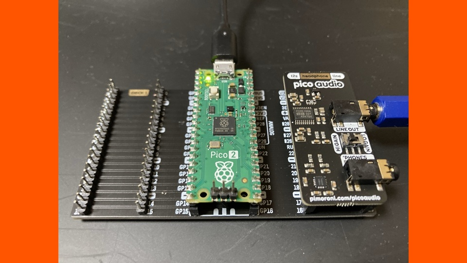

# Digital Synth PRA32-U2 v3.17.4

- 2026-10-25 ISGK Instruments
- <https://github.com/risgk/digital-synth-pra32-u2>
- [English README](./README.md) の抄訳です (英語版が正です)。詳しい仕様は英語版を参照してください
    - 英語のドキュメントは、必要に応じて Web ブラウザーなどの自動翻訳を使ってお読みください

## 概要

- **PRA32-U2** は、Raspberry Pi Pico 2/RP2350 用の 4 ボイス・ポリフォニック・シンセサイザーです
    - Chorus FX と Delay/Reverb FX を内蔵し、その後に Output Compressor (リミッターを兼ねる) があります
    - MIDI で制御します -- PRA32-U2 は MIDI 音源モジュールです
    - パラメーターをユーザー・プログラムとフラッシュに書き込む機能があります
    - PRA32-U2 は PRA32-U (Raspberry Pi Pico/RP2040 用) の後継として始まりましたが、今では別のシンセサイザーです
- **I2S DAC** ハードウェア (例えば Pimoroni Pico Audio Pack) が必要です
    - Pico Audio Pack 用のケース (3D プリンター用データ): [Pico Audio Pack Case by YuuichiAkagawa](https://www.thingiverse.com/thing:6404203) (Thingiverse)
    - Adafruit PCM510x I2S DAC や GY-PCM5102 も使えます ([I2S DAC ボードの接続](#i2s-dac-ボードの接続) を参照)
    - I2S の代わりに PWM Audio も使えます (英語版の [PWM Audio](./PRA32-U2-Modification-Guide.md#pwm-audio-optional) を参照)
- ビルド済みの UF2 ファイル ("bin" フォルダー内): 改造せずに使うだけなら、Arduino IDE は不要です
    - BOOTSEL ボタンを押しながら Raspberry Pi Pico 2 を PC につなぎ、UF2 ファイルを "RP2350" ドライブにコピーしてください
    - PRA32-U2/M (推奨): "Digital-Synth-PRA32-U2-M-Pimoroni-Pico-Audio-Pack.uf2" は Raspberry Pi Pico 2 と Pimoroni Pico Audio Pack 用です
        - PRA32-U2 の上位互換です: Main Synth は PRA32-U2 と同じように動き、Sub Synth と Layering が加わります ([PRA32-U2/M](#pra32-u2m-pra32-u2-multi-timbre-edition) を参照)
        - 注意: MIDI チャンネル 2-4 と 14-16 にも反応します (初期設定)。これらのチャンネルを他の機器に使う場合は、PRA32-U2 を使ってください
    - PRA32-U2: "Digital-Synth-PRA32-U2-Pimoroni-Pico-Audio-Pack.uf2" は Raspberry Pi Pico 2 と Pimoroni Pico Audio Pack 用です
- Arduino IDE と Arduino-Pico (Earle F. Philhower, III 氏による) で改造できます: [改造の準備](#改造の準備) を参照してください (例えば他の I2S DAC、PWM Audio、パネルを使う場合)
- オプション: 部品を追加することで、**[PRA32-U2/P](./README-PRA32-U2-P.md)** (PRA32-U2 with Panel、英語) と **PRA32-U2/M/P** も構成できます
- **[PRA32-U2 Native](./PRA32-U2-Native/README.md)** (英語): PC 用のソフトウェア・シンセサイザー版 PRA32-U2 (VST3 プラグインとスタンドアロン・アプリケーション)
- **[PRA32-U2 Web](./PRA32-U2-Web/README.md)** (英語): Web ブラウザーで動くソフトウェア・シンセサイザー版 PRA32-U2 (PRA32-U2 Editor に内蔵)

## はじめかた

1. Raspberry Pi Pico 2 H を Pico Audio Pack に差し込み、Pico Audio Pack のライン出力をアンプかアクティブ・スピーカーにつなぎます
2. UF2 ファイルを Raspberry Pi Pico 2 にコピーします (上記のビルド済みの UF2 ファイルを参照)
3. USB で PC につなぐと、USB MIDI デバイス "PRA32-U2" (PRA32-U2/M では "PRA32-U2/M") として見えます
4. Google Chrome か Microsoft Edge で [PRA32-U2 Editor](#pra32-u2-editor) を開き、"MIDI Out" で "PRA32-U2" を選んで、ソフトウェア・キーボードを弾きます (MIDI チャンネル 1)

## I2S DAC ボードの接続

- Pimoroni Pico Audio Pack は、Raspberry Pi Pico 2 H を差し込むだけなので、配線は不要です
- Adafruit PCM510x I2S DAC と GY-PCM5102 は、次のようにつなぎます (ビルド済みの UF2 ファイルをそのまま使えます)

    | Raspberry Pi Pico 2                       | Adafruit PCM510x I2S DAC | GY-PCM5102 |
    | :---------------------------------------- | :----------------------- | :--------- |
    | GP22 (Pin 29) (オプション、ミュート・オフ) | MU                       | XSMT       |
    | GP9 (Pin 12)                              | DIN                      | DIN        |
    | GP10 (Pin 14)                             | BCK                      | BCK        |
    | GP11 (Pin 15)                             | WSEL                     | LCK        |
    | VBUS (Pin 40) または 3V3(OUT) (Pin 36)    | VIN                      | VIN        |
    | GND                                       | GND                      | GND、SCK   |

- GY-PCM5102 の裏面のはんだジャンパーの推奨設定 (はんだ付けされていない場合): H1L: L、H2L: L、H3L: H、H4L: L
- 他の I2S DAC を使う場合は、英語版の [I2S (Default)](./PRA32-U2-Modification-Guide.md#i2s-default) を参照してください

## ドキュメント (英語)

- [Change History](./PRA32-U2-Change-History.md) (変更履歴)
- [Parameter Guide](./PRA32-U2-Parameter-Guide.md) (パラメーター・ガイド)
    - パラメーター名は、PRA32-U2 Editor とパネルの表示に合わせて英語のままです
    - まず冒頭の [Main Parameters](./PRA32-U2-Parameter-Guide.md#main-parameters) をご覧ください: 主なパラメーター (Editor の最初の 32 個と、FX のレベル 2 個) の一覧です
    - 音作りは、"#23 Initial" よりも、FX が有効な "#19 Plain Poly" から始めるのがお勧めです
- [MIDI Implementation Chart](./PRA32-U2-MIDI-Implementation-Chart.md) (MIDI インプリメンテーション・チャート)
- [Block Diagrams](./PRA32-U2-Block-Diagrams.md) (ブロック図)
    - Osc、Filter、Chorus FX、Delay FX、Reverb、Output Compressor、PRA32-U2/M のブロック図と、Wave Table のグラフです
- [Modification Guide](./PRA32-U2-Modification-Guide.md) (改造ガイド)
    - USB MIDI、UART MIDI、I2S、オーディオ・バッファー、PWM Audio の設定と、PWM Audio の簡易回路です
- [Development](./PRA32-U2-Development.md) (開発ノート)
    - コードを変更する人向けです。デバッグプリント、2 つのコアでの動き、処理時間を一定に保つ方針 (ブランチレスなど)、負荷の推定、フラッシュへの書き込み、ツールの説明です
- README の次の節は英語版のみです
    - [Synthesizer Block Diagram](./README.md#synthesizer-block-diagram)
    - [Files](./README.md#files)

## 改造の準備

- **Arduino IDE** をインストールしてください
    - 注意: Update Method: "Default (UF2)" 以外を使うと、スケッチの書き込み中に大きなノイズが出ます
- Arduino-Pico = **Raspberry Pi Pico/RP2040/RP2350** (Earle F. Philhower, III 氏による) コアをインストールしてください
    - 動作確認したバージョンは英語版の [Preparation for Modification](./PRA32-U2-Modification-Guide.md#preparation-for-modification) を参照してください
- Arduino **MIDI Library** (Francois Best 氏、lathoub 氏による) をインストールしてください
- Arduino IDE の "ツール" メニューで USB Stack: "Adafruit TinyUSB" を選んでください (USB MIDI 用)
- MIDI チャンネルを変えるには、"Digital-Synth-PRA32-U2.ino" の `PRA32_U2_MIDI_CH` を変更してください (0 始まりで、0 が MIDI チャンネル 1 です)

## PRA32-U2 Editor

- "pra32-u2-editor.html": PRA32-U2 用のエディター (MIDI コントローラー) アプリケーション、HTML アプリ (Web アプリ)
    - MIDI チャンネルは "MIDI Ch" で選んでください (初期値は 1)
- Web MIDI API に対応した Google Chrome か Microsoft Edge をお勧めします
    - その他の Web ブラウザー (例えば Safari) については、[PRA32-U2 Web](./PRA32-U2-Web/README.md) の "Web browsers" (英語) を参照してください
    - Safari (Mac、iPhone、iPad) と iPhone・iPad のすべての Web ブラウザーは Web MIDI API に対応していないため、
      PRA32-U2 Editor は PRA32-U2 Web (Built-in) でだけ使えます (PRA32-U2 や他の MIDI 機器とはつながりません)
- "MIDI Out" のリストで "PRA32-U2" (PRA32-U2/M の場合は "PRA32-U2/M" など) を選んでください
    - PRA32-U2 なしで [PRA32-U2 Web](./PRA32-U2-Web/README.md) を使うには、"PRA32-U2 Web (Built-in)" を選んでください

### プログラムとプリセット

- PRA32-U2 Editor は、パラメーターをコントロール・チェンジで PRA32-U2 に送ります。Editor のプリセットは Editor のもので、PRA32-U2 は自身のプログラム (#0-31) を持っています
- PRA32-U2 Editor を経由すると、プログラム・チェンジの扱いが変わります
    - "MIDI In" から (Editor の MIDI Ch で) 届いたプログラム・チェンジは PRA32-U2 に送らず、Editor がプリセットを読み込んで、そのパラメーターをコントロール・チェンジで送ります
    - #0-15 は Editor のユーザー・プリセット (ブラウザーに保存) で、PRA32-U2 のプログラム #0-15 (Write で書き込んだもの) ではありません
    - #16-31 はファクトリー・プリセットです (PRA32-U2 のプログラム #16-31 と同じ)
    - PRA32-U2 自身のプログラムを選ぶには、Editor を経由せずにプログラム・チェンジを送るか、"Save & Load" の Program Change ボタンを使ってください
- Editor で作った音を PRA32-U2 に書き込んでおけば、後で Editor なしで呼び出せます
    1. Write: Editor の "Save & Load" にある Write ボタン (#0-15) で、現在のパラメーターを PRA32-U2 のプログラムに書き込みます
       (フラッシュにも書き込まれるので、電源を切っても残ります)。書き込みの前に、Editor に表示されているパラメーターを送り直します
    2. Editor を経由せずに、PRA32-U2 にプログラム・チェンジ #0-15 を直接送ると、そのプログラムを呼び出せます
- Randomize Synth: シンセのパラメーターをランダムに設定します (プログラム・チェンジ #127、またはコントロール・チェンジ #111 を Off (63 以下) から On (64 以上) に)
    - 変えるのは、Editor の最初の 32 個のうち、Voice Mode と Amp Gain を除くパラメーターです
    - PRA32-U2 に直接送れば、PRA32-U2 自身でも実行できます

### Editor を使わない場合

- PRA32-U2 は、PRA32-U2 Editor を使わずに MIDI で制御することもできます (例えば DAW や MIDI キーボードから)
- 電源を入れたときのプログラムは #0 です。Write で書き込んだプログラムは、プログラム・チェンジ #0-15 で呼び出せます (上記)
- 対応している機能は [MIDI Implementation Chart](./PRA32-U2-MIDI-Implementation-Chart.md) (英語) を参照してください

### 主な機能

- ファクトリー・プリセット (#16-31) とユーザー・プリセット (#0-15) の読み込み
- ユーザー・プリセットはブラウザーに保存され、Store で 10 文字までの名前 (ASCII の英数字と記号) を付けられます
- JSON ファイルへのエクスポートと、JSON ファイルからのインポート
- Randomize Synth と Randomize FX: シンセや FX のパラメーターをランダムに設定します
- Undo: 直前の変更 (プリセット、Randomize、Import、スライダーの操作) の前のパラメーターに戻します (200 段階まで)。Redo で進めます (Ctrl+Z と、Ctrl+Y または Ctrl+Shift+Z でも。Mac では Command)
- "MIDI" と "Actions & Presets" ("Save & Load" を含む) はそれぞれ隠せるので、パラメーターに画面を広く使えます
- ボタンやスライダーなどは、どのブラウザーや OS でも同じ見た目 (Chrome 相当) です。タッチ画面では、スライダーのつまみが大きく、ボタンが高くなります
- Software Keyboard: マウス、タッチ、PC のキーボード (A - K が C - C、W - U が黒鍵、Z / X がオクターブ) で弾けます
    - パラメーターの下にあり、パラメーターをスクロールしても画面の下に残るので、弾きながらパラメーターを変えられます。隠すこともできます (Panic は表示されたまま。隠すと Hold はオフになります)
    - ノートオンとノートオフのベロシティを入力できます (1-127、初期値は 100 と 64)
    - Hold がオンの間は、離した鍵盤のノートが鳴り続けます (Hold をオフにするか、Panic で止まります)
    - 鍵盤の下のスライダーで、Pitch Bend (離すと中央に戻ります)、Modulation Wheel、Breath Controller、Expression、Sustain Pedal、Portamento Switch、Channel Pressure を送れます (Performance Controls。スマホなどでは、鍵盤とは別に隠せます)

## PRA32-U2/M (PRA32-U2 Multi-Timbre Edition)

- Basic Channel は PRA32-U2 の MIDI チャンネル (初期値 1、`PRA32_U2_MIDI_CH`) で、各シンセのチャンネルはそれを基準に決まります
- Basic Channel + 0 (初期値 1) が Main Synth、+ 1 から + 3 (初期値 2-4) が Sub Synth 1-3 (Mono) です
    - Sub Synth は、Main Synth が Mono 系のモードのときだけ処理されます
- Layering: Basic Channel - 3 から - 1 (初期値 14-16) で、複数のシンセを同時に制御します
- 詳しくは英語版の [PRA32-U2/M](./README.md#pra32-u2m-pra32-u2-multi-timbre-edition) を参照してください

## 改造サンプル

- "customization-examples" フォルダーのファイルです。それぞれがスケッチで、"Digital-Synth-PRA32-U2.ino" (PRA32-U2/M では "Digital-Synth-PRA32-U2-M.ino") の代わりに使います
- **Digital Synth PRA32-U2 (Lite)** と **Digital Synth PRA32-U2/M (Lite)**: Saw、Sqr、WT で Osc 1 Shape と Morph が効かない代わりに、シンセを 1 つのコア (コア 0) で処理します
    - "...Lite-Core-0-Only.txt": 通常のスケッチと同じく、MIDI (USB MIDI と UART MIDI)、パネル、デバッグプリントがあります。コア 1 はパネルの更新とデバッグプリントだけを行います
    - "...Lite-Core-1-Only.txt": シンセと音声出力だけで、MIDI、パネル、デバッグプリントはありません (このままでは音が出ません)。`loop()` の `// TODO` に自分のコードを書いて、シンセを鳴らすための雛形です
- 詳しくは英語版の [Customization Examples](./README.md#customization-examples) を参照してください

## うまく動かない場合

- "RP2350" ドライブが出てこない
    - データ通信に対応した USB ケーブルを使ってください (充電専用のケーブルでは認識されません)
    - BOOTSEL ボタンを押したまま USB ケーブルをつなぎ、つないでからボタンを離してください
- PRA32-U2 Editor の "MIDI Out" のリストに "PRA32-U2" (または "PRA32-U2/M" など) が出てこない
    - Google Chrome か Microsoft Edge を使い、MIDI デバイスへのアクセスを許可してください
    - PRA32-U2 Editor は、開いたときに MIDI ポートの一覧を作ります。Editor を開いた後に PRA32-U2 をつないだ場合は、ページを再読み込みしてください
- 音が出ない
    - I2S DAC の配線を確認してください (GY-PCM5102 の場合は、SCK を GND につないでいるかと、裏面のはんだジャンパーも確認してください)
    - PRA32-U2 Editor の "MIDI Ch" が、PRA32-U2 の MIDI チャンネル (初期値 1) と合っているか確認してください
- ノイズが気になる
    - USB 通信のノイズの影響を受けることがあります。英語版の [UART MIDI](./PRA32-U2-Modification-Guide.md#uart-midi) を試してください
    - RC フィルターなしの PWM Audio では、レベルを下げてください (英語版の [PWM Audio](./PRA32-U2-Modification-Guide.md#pwm-audio-optional) を参照)
- 音が歪む
    - Amp Gain を下げてください (Filter Resonance や Osc 1 Shape/Morph が高いと、音が大きくなります)
    - FX Routing が Dry の場合は Output Compressor を通らないため、大きな音はソフトクリップで歪みます。Cmp などを選んでください
- ポルタメントが掛からない
    - Portamento Time が 0 になっていないか確認してください
    - Portamento Mode が Aut か、Sw の場合は Portamento Switch (コントロール・チェンジ #65) が On か確認してください
    - Legato Portamento (Voice Mode: LP) では、レガートで弾いたときだけポルタメントが掛かります
    - Polyphonic のときは、Voice Assign Mode が 2 か 4 のときだけポルタメントが掛かります

## ライセンス

- CC0 1.0 です。正式な文面は英語版の [License](./README.md#license) を参照してください
