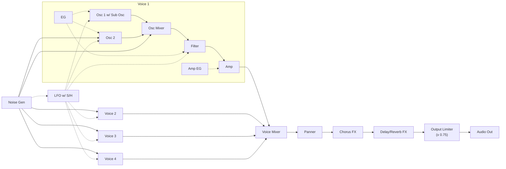
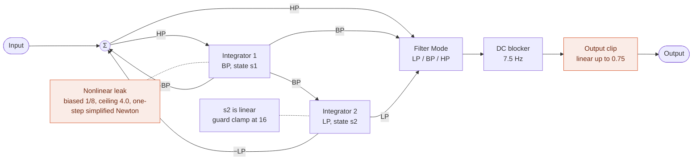
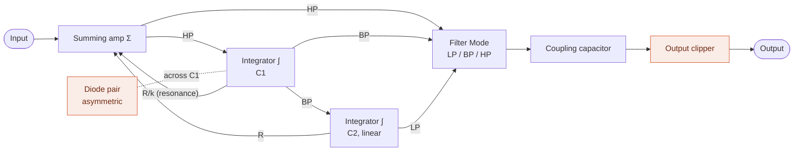
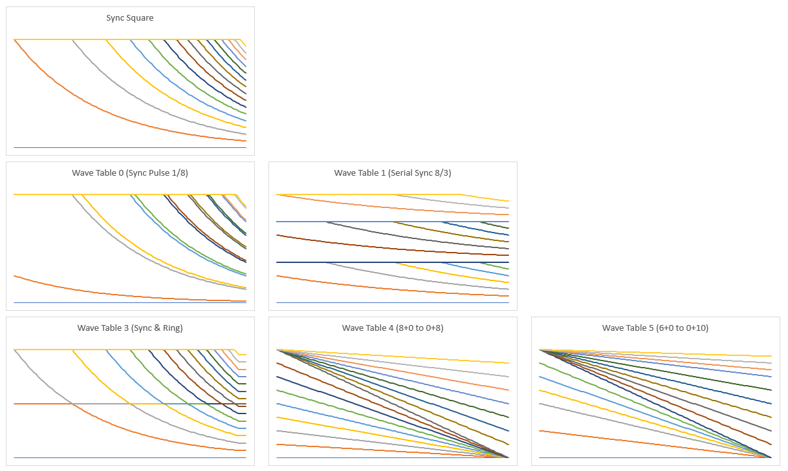

# Digital Synth PRA32-U2 v3.15.0

- 2026-10-16 ISGK Instruments
- <https://github.com/risgk/digital-synth-pra32-u2>
- [日本語版 README (抄訳)](./README.ja.md)


## Overview

- **PRA32-U2** is a 4-Voice Polyphonic Synthesizer for Raspberry Pi Pico 2/RP2350
    - Built-in Chorus and Delay/Reverb FX, followed by the Output Limiter
    - Controlled by MIDI -- PRA32-U2 is a MIDI sound module
    - Can write the parameters to the user programs and the flash
    - PRA32-U2 started as the successor to PRA32-U (for Raspberry Pi Pico/RP2040), and has since become a different synthesizer
- An **I2S DAC** hardware (e.g. Pimoroni Pico Audio Pack) is required
    - A case for Pico Audio Pack (3D printing data): [Pico Audio Pack Case by YuuichiAkagawa](https://www.thingiverse.com/thing:6404203) (Thingiverse)
- Prebuilt UF2 files (in the "bin" folder): Arduino IDE is not required to use PRA32-U2 without modification
    - Connect Raspberry Pi Pico 2 to a PC while pressing the BOOTSEL button, and copy a UF2 file to the "RP2350" drive
    - PRA32-U2/M (Recommended): "Digital-Synth-PRA32-U2-M-Pimoroni-Pico-Audio-Pack.uf2" is for Raspberry Pi Pico 2 and Pimoroni Pico Audio Pack
        - A superset of PRA32-U2: the Main Synth (Basic Channel + 0) works the same as PRA32-U2, and the Sub Synths and Layering are added
        - NOTE: It also responds to MIDI Channels 2-4 and 14-16 (by default); use PRA32-U2 if these channels are used for other devices
    - PRA32-U2: "Digital-Synth-PRA32-U2-Pimoroni-Pico-Audio-Pack.uf2" is for Raspberry Pi Pico 2 and Pimoroni Pico Audio Pack
- Modifiable with Arduino IDE and Arduino-Pico (by Earle F. Philhower, III): see [Preparation for Modification](#preparation-for-modification) (e.g. for other I2S DACs, PWM Audio, or the panel)
- Optional
    - **[PRA32-U2/M](#pra32-u2m-pra32-u2-multi-timbre-edition-optional)** (PRA32-U2 Multi-Timbre Edition) can also be configured
    - **[PRA32-U2/P](./README-PRA32-U2-P.md)** (PRA32-U2 with Panel) and **PRA32-U2/M/P** (PRA32-U2 Multi-Timbre Edition with Panel) can also be configured by adding certain parts
- **[PRA32-U2 Native](./PRA32-U2-Native/README.md)**: a software synthesizer (VST3 plugin and standalone application) version of PRA32-U2 for PCs
- **[PRA32-U2 Web](./PRA32-U2-Web/README.md)**: a software synthesizer version of PRA32-U2 that runs in a Web browser, built into PRA32-U2 Editor


## [Change History](./PRA32-U2-Change-History.md)


## [Parameter Guide](./PRA32-U2-Parameter-Guide.md)


## [MIDI Implementation Chart](./PRA32-U2-MIDI-Implementation-Chart.md)


## Synthesizer Block Diagram




## Filter Diagrams

A zero-delay feedback state variable filter. The band pass integrator leaks, more and more as
the band pass bends into a soft clip curve (ceiling 4.0), and that is what holds the resonance
down; at small levels the leak is next to nothing, so the pass band passes nearly clean. The
loop equation, leak included, is solved every sample by the one-step simplified Newton method
(the chord method, with the slope held at the linear part) from the linear solution,
which needs no division and lands close to the root. The leak's rate is fixed in time, so the sound
does not change with the sampling rate. The low pass state stays linear, with a clamp at 16 as
a guard that ordinary use never reaches. The curve is biased by 1/8, so that the leak adds even
harmonics as the band pass is driven (at a high Resonance or near the cutoff), with its
small-signal gain made up for, so that the resonance is kept; a DC blocker on the output
removes the DC that comes with it. The output clip comes last. Above the Filter
Resonance 122, k turns negative and the loop oscillates.



The same structure redrawn as an op-amp integrator filter. The asymmetric diode pair stands for
the biased nonlinear leak, the coupling capacitor for the DC blocker, and the output clipper for the
output clip. It is an interpretation, not a reproduction of an actual circuit.




## Wave Table Graphs




## Preparation for Modification

- Please install **Arduino IDE**
    - NOTE: Large noise is generated during the sketch upload if other than Update Method: "Default (UF2)" is used
    - Info: <https://www.arduino.cc/en/software>
- Please install Arduino-Pico = **Raspberry Pi Pico/RP2040/RP2350** (by Earle F. Philhower, III) core
    - Additional Board Manager URL: <https://github.com/earlephilhower/arduino-pico/releases/download/global/package_rp2040_index.json>
    - This sketch is tested with version **6.2.0**: <https://github.com/earlephilhower/arduino-pico/releases/tag/6.2.0>
    - Info: <https://github.com/earlephilhower/arduino-pico>
- Please install Arduino **MIDI Library** (by Francois Best, lathoub)
    - This sketch is tested with version **5.0.2**: <https://github.com/FortySevenEffects/arduino_midi_library/releases/tag/5.0.2>
    - Info: <https://github.com/FortySevenEffects/arduino_midi_library>


## Features

### MIDI

#### USB MIDI Device

- NOTE: Select USB Stack: "Adafruit TinyUSB" in the Arduino IDE "Tools" menu
- To disable, comment out `#define PRA32_U2_USE_USB_MIDI` in "Digital-Synth-PRA32-U2.ino"
- MIDI Device Name: "PRA32-U2" ("PRA32-U2/M" for PRA32-U2/M, "PRA32-U2/P" for PRA32-U2/P, and "PRA32-U2/M/P" for PRA32-U2/M/P)


#### UART MIDI

- UART MIDI helps avoid noise caused by USB communication
- To disable, comment out `#define PRA32_U2_USE_UART_MIDI` in "Digital-Synth-PRA32-U2.ino"
- Modify `PRA32_U2_UART_MIDI_SPEED`, `PRA32_U2_UART_MIDI_TX_PIN`, and `PRA32_U2_UART_MIDI_RX_PIN`
    - Speed: 31250 bps (default, for DIN/TRS MIDI) or 38400 bps (for PC)
    - GP4 and GP5 pins are used by UART1 TX and UART1 RX by default
    - You can also use `SerialPIO` (a PIO-based UART on any pins) by making the following changes:

        ```cpp
        #define PRA32_U2_UART_MIDI_TX_PIN              (4)
        #define PRA32_U2_UART_MIDI_RX_PIN              (5)
        SerialPIO mySerial(PRA32_U2_UART_MIDI_TX_PIN, PRA32_U2_UART_MIDI_RX_PIN, 256);  // FIFO: 256 bytes
        #define PRA32_U2_UART_MIDI_SERIAL              mySerial
        ```

        ```cpp
        //  PRA32_U2_UART_MIDI_SERIAL.setTX(PRA32_U2_UART_MIDI_TX_PIN);
        //  PRA32_U2_UART_MIDI_SERIAL.setRX(PRA32_U2_UART_MIDI_RX_PIN);
        //  PRA32_U2_UART_MIDI_SERIAL.setFIFOSize(256);  // To absorb bursts (default: 32 bytes)
        ```

- DIN/TRS MIDI is available by using (and modifying) Adafruit MIDI FeatherWing Kit, for example
    - Adafruit [MIDI FeatherWing Kit](https://www.adafruit.com/product/4740) (Product ID: 4740)
    - M5Stack [Midi Unit with DIN Connector (SAM2695)](https://shop.m5stack.com/products/midi-unit-with-din-connector-sam2695) (SKU: U187) in Separate mode
    - Kinoshita Laboratory [MIDI-UART interface-san Kit](https://www.tindie.com/products/kinoshitalab/midi-uart-interface-san-kit/)
    - 木下研究所 [MIDI-UARTインターフェースさん キット](https://www.switch-science.com/products/8117) (Shipping to Japan only)
    - necobit電子 [MIDI Unit for GROVE](https://necobit.com/denshi/grove-midi-unit/) (Shipping to Japan only)
    - necobit電子 [MIDI Unit Mini for GROVE](https://necobit.com/denshi/midi-unit-mini-for-grove/) (Shipping to Japan only)
- We recommend using [Hairless MIDI<->Serial Bridge](https://projectgus.github.io/hairless-midiserial/) on PC
    - On Windows, we recommend using [loopMIDI](https://www.tobias-erichsen.de/software/loopmidi.html) (virtual loopback MIDI cable)
    - On Mac, a virtual MIDI bus (port) can be created by using the IAC bus


### Audio Output

#### I2S (Default)

- Use an I2S DAC (Texas Instruments PCM5100A, PCM5101A, or PCM5102A is recommended), Sampling Rate: 48 kHz, Bit Depth: 24 bit
    - NOTE: I2S DACs that require MCLK are not supported
- NOTE: The RP2350 system clock (sysclk) changes to overclocked 153.6 MHz, so that the sampling rate is exactly 48 kHz
- PRA32-U2's own PIO I2S Output ("pra32-u2-i2s.h") is used (Arduino-Pico I2S Library is not used)
    - The slot width is 32 bits (BCLK = 64 fs), and the 24-bit samples are sent left-justified
    - BCLK and LRCLK are generated without jitter (the PIO clock divider is an integer)
    - The output buffer is read by DMA without interrupts (lower CPU usage)
- Modify `PRA32_U2_I2S_DAC_MUTE_OFF_PIN`, `PRA32_U2_I2S_DATA_PIN`, `PRA32_U2_I2S_BCLK_PIN`,
  `PRA32_U2_I2S_SWAP_BCLK_AND_LRCLK_PINS`, and `PRA32_U2_I2S_SWAP_LEFT_AND_RIGHT`
  in "Digital-Synth-PRA32-U2.ino" to match the hardware configuration
    - Define `PRA32_U2_I2S_DAC_MUTE_OFF_PIN` and connect this pin to the I2S DAC mute off pin to reduce click noise when writing the parameters to the flash
- The default setting is for Pimoroni [Pico Audio Pack](https://shop.pimoroni.com/products/pico-audio-pack) (PIM544)
    - [Adafruit PCM5102 I2S DAC](https://www.adafruit.com/product/6250) (Product ID: 6250), [Adafruit PCM5100 I2S DAC](https://www.adafruit.com/product/6251) (Product ID: 6251), and GY-PCM5102 (PCM5102A I2S DAC Module) can also be used

    ```
    #define PRA32_U2_I2S_DAC_MUTE_OFF_PIN          (22)
    #define PRA32_U2_I2S_DATA_PIN                  (9)
    #define PRA32_U2_I2S_BCLK_PIN                  (10)  // LRCLK Pin is PRA32_U2_I2S_BCLK_PIN + 1
    #define PRA32_U2_I2S_SWAP_BCLK_AND_LRCLK_PINS  (false)
    #define PRA32_U2_I2S_SWAP_LEFT_AND_RIGHT       (false)
    ```

    - Pico Audio Pack requires no wiring: just plug Raspberry Pi Pico 2 H into it
    - Wiring of Adafruit PCM510x I2S DAC and GY-PCM5102 (the prebuilt UF2 files can be used as they are)

        | Raspberry Pi Pico 2                       | Adafruit PCM510x I2S DAC | GY-PCM5102 |
        | :---------------------------------------- | :----------------------- | :--------- |
        | GP22 (Pin 29) (Optional, Mute Off)        | MU                       | XSMT       |
        | GP9 (Pin 12)                              | DIN                      | DIN        |
        | GP10 (Pin 14)                             | BCK                      | BCK        |
        | GP11 (Pin 15)                             | WSEL                     | LCK        |
        | VBUS (Pin 40) or 3V3(OUT) (Pin 36)        | VIN                      | VIN        |
        | GND                                       | GND                      | GND, SCK   |

    - GY-PCM5102: Recommended settings of the solder jumpers on the back (if not soldered): H1L: L, H2L: L, H3L: H, H4L: L

- The following setting is for [Pimoroni Pico VGA Demo Base](https://shop.pimoroni.com/products/pimoroni-pico-vga-demo-base) (PIM553)

    ```
    //#define PRA32_U2_I2S_DAC_MUTE_OFF_PIN          (0)
    #define PRA32_U2_I2S_DATA_PIN                  (26)
    #define PRA32_U2_I2S_BCLK_PIN                  (27)  // LRCLK Pin is PRA32_U2_I2S_BCLK_PIN + 1
    #define PRA32_U2_I2S_SWAP_BCLK_AND_LRCLK_PINS  (false)
    #define PRA32_U2_I2S_SWAP_LEFT_AND_RIGHT       (false)
    ```

- The following setting is for [Waveshare Pico-Audio](https://www.waveshare.com/wiki/Pico-Audio) Initial Version (WAVESHARE-20167)

    ```
    //#define PRA32_U2_I2S_DAC_MUTE_OFF_PIN          (0)
    #define PRA32_U2_I2S_DATA_PIN                  (26)
    #define PRA32_U2_I2S_BCLK_PIN                  (27)  // LRCLK Pin is PRA32_U2_I2S_BCLK_PIN + 1
    #define PRA32_U2_I2S_SWAP_BCLK_AND_LRCLK_PINS  (false)
    #define PRA32_U2_I2S_SWAP_LEFT_AND_RIGHT       (true)
    ```


#### Audio Buffer

- The size of the output buffer (the maximum output latency) is `PRA32_U2_I2S_BUFFERS` * `PRA32_U2_I2S_BUFFER_WORDS` frames
    - The default is 2 * 64 = 128 frames (2.7 ms)
    - Smaller values reduce the latency, but may cause audio dropouts when the processing of a loop takes longer
- `PRA32_U2_I2S_BUFFER_WORDS` is also the number of frames processed in each loop (the default is 64 frames)
- These settings are also used for PWM Audio
- The latency from receiving a MIDI message to the audio output is about 3.7-5.0 ms (4.3 ms on average) by default (2.7 ms + 0-1.3 ms + 1 ms, below)
    - The output buffer is almost always full, so the frames processed in a loop are output about 2.7 ms after the loop starts
    - The MIDI messages are read once at the start of each loop (every 64 frames, 1.3 ms)
    - The Output Limiter delays the output by 1 ms (look-ahead), even when it is off
    - The transmission time of the MIDI messages (about 1 ms for 3 bytes with UART MIDI) and the latency of the DAC are not included


#### PWM Audio (Optional)

- PWM Audio can also be used instead of I2S (PWM Audio does not require an I2S DAC hardware)
    - PRA32-U2's own PWM Audio Output ("pra32-u2-pwm-audio.h") is used (Arduino-Pico PWMAudio Library is not used)
    - The PWM level (3200 steps) is quantized with the 1st-order noise shaping and the TPDF dither, which moves the quantization noise to the high frequencies
    - Each sample is output as 4 PWM periods of 800 cycles (PWM carrier: 192 kHz), and the level is split into them (e.g. 801 = 201 + 200 + 200 + 200)
        - The resolution is the same as 1 PWM period of 3200 cycles (48 kHz carrier), but the carrier is easier to filter out
        - This reduces the beeps or whines of some active speakers (especially ones with an ADC/DSP) when the RC filters are omitted
        - Define `PRA32_U2_PWM_AUDIO_SUBPERIODS` as 1, 2, 4 (default), or 8 before including "pra32-u2-pwm-audio.h" to change it (carrier: 48, 96, 192, or 384 kHz)
    - NOTE: Probably smaller output volume than I2S DAC boards
    - The parameters are written to the flash after fading out the output (about 4 ms), and the output is silent while writing (about 50-100 ms)
    - We recommend adding RC filter (post LPF) circuits to reduce the PWM ripples
        - A 1st-order LPF with a cutoff frequency 7.2 kHz (R = 220 ohm, C = 100 nF) works well
        - They also reduce the radio noise (EMI) radiated from the cables carrying the square waves: put them close to the pins
    - Without the RC filters, the PWM ripples (3.3 V square waves) reach the connected device along with the audio,
      and may saturate its input (e.g. of an audio interface) and cause beeps or noises, even when its level meter looks fine
        - Reduce the level with a volume control (e.g. a cable with an inline stereo volume control), resistors, or the input gain (volume) of the connected device
        - Start with the volume turned down: at the top, the full 3.3 V square waves reach the device
    - See "PWM audio" in [Hardware design with RP2040](https://datasheets.raspberrypi.com/rp2040/hardware-design-with-rp2040.pdf)
      for details on PWM audio
- NOTE: The RP2350 system clock (sysclk) changes to overclocked 153.6 MHz (the same as I2S), regardless of CPU Speed in the Arduino IDE "Tools" menu
    - The sample period is exactly 3200 cycles (Sampling Rate: 48 kHz), and the PWM period is 800 cycles (by default)
- Uncomment `//#define PRA32_U2_USE_PWM_AUDIO_INSTEAD_OF_I2S`
  in "Digital-Synth-PRA32-U2.ino" and modify `PRA32_U2_PWM_AUDIO_L_PIN` and `PRA32_U2_PWM_AUDIO_R_PIN`
- The following setting is for Pimoroni Pico VGA Demo Base (PIM553)

    ```
    #define PRA32_U2_PWM_AUDIO_L_PIN               (28)
    #define PRA32_U2_PWM_AUDIO_R_PIN               (27)
    ```


## Files

- "Digital-Synth-PRA32-U2.ino" is an Arduino sketch for Raspberry Pi Pico/RP2040/RP2350 core
    - Modify `PRA32_U2_MIDI_CH` to change the MIDI Channel (0-based: 0 is MIDI Channel 1)
- "pra32-u2-make-sample-wav-file.cc" is for debugging on PC
    - GCC (g++) for PC is required
    - "pra32-u2-make-sample-wav-file-cc.bat" makes a sample WAV file (working on Windows)
- "pra32-u2-generate-*.rb" generates source or header files
    - A Ruby execution environment is required


## PRA32-U2 Editor

- "pra32-u2-editor.html": Editor (MIDI Controller) Application for PRA32-U2, HTML App (Web App)
    - Select the MIDI Channel in "MIDI Ch" (1 by default, `PRA32_U2_MIDI_CH`)
- We recommend using Google Chrome or Microsoft Edge, which implement Web MIDI API
    - Refer to "Web browsers" in [PRA32-U2 Web](./PRA32-U2-Web/README.md) for the other Web browsers (e.g. Safari)
    - Safari (Mac, iPhone, iPad) and all the Web browsers on iPhone and iPad do not support Web MIDI API,
      so PRA32-U2 Editor can be used only with PRA32-U2 Web (Built-in), not with PRA32-U2 or other MIDI devices
- Select "PRA32-U2" (or "PRA32-U2/M", etc.) in the list "MIDI Out"
    - Select "PRA32-U2 Web (Built-in)" to use [PRA32-U2 Web](./PRA32-U2-Web/README.md), without PRA32-U2
- Functions
    - Program Changes via PRA32-U2 Editor (from "MIDI In" on the MIDI Ch of the Editor) are not passed to PRA32-U2:
      PRA32-U2 Editor recalls the preset instead, and sends its parameters as Control Changes
        - #0-15: the user presets of PRA32-U2 Editor (stored in the Web browser), not the programs #0-15 of PRA32-U2 (written by Write)
        - #16-31: the factory presets (the same as the programs #16-31 of PRA32-U2)
        - To select the programs of PRA32-U2 itself, send Program Changes to PRA32-U2 directly (without PRA32-U2 Editor),
          or use the Program Change buttons (in "Save & Load")
    - When Program Change #127 is entered or Control Change #111 is changed from Off (63 or lower) to On (64 or higher), "Randomize Synth" is processed
    - PRA32-U2 Editor stores the current control values and the user presets (#0-15) in a Web browser (localStorage)
    - Current parameter values and user presets (#0-15) can be imported/exported from/to JSON files
    - User presets: a name of up to 10 ASCII letters, digits, and symbols can be given by Store (shown on the User Preset buttons)
    - Undo: back to the parameters before the last preset, Randomize, or Import (Undo again: Redo)
    - Software Keyboard
        - While Hold is on, the keys released keep their notes on (turning Hold off turns them off)
        - The PC keyboard can also be played while it is shown (A - K for C - C, W - U for the black keys, and Z / X for the octave);
          some PC keyboards cannot take many keys at the same time (e.g. a chord of 4 notes)
        - The velocities of Note On and Note Off can be entered (1-127, 100 and 64 by default)
        - Pitch Bend (springs back to the center), Modulation Wheel, Breath Controller, Expression, Sustain Pedal, Portamento Switch,
          and Channel Pressure can be sent from the sliders below the keyboard
- When not using PRA32-U2 Editor (e.g. with a DAW or a MIDI keyboard)
    - PRA32-U2 can also be controlled by MIDI without using PRA32-U2 Editor
    - Sounds made with PRA32-U2 Editor can be written to PRA32-U2, and recalled later without PRA32-U2 Editor
        1. Write: press a Write button (#0-15, in "Save & Load") of PRA32-U2 Editor, to write the current parameters
           to the program of PRA32-U2 (also to the flash, so that they are kept after the power is turned off);
           the parameters shown in PRA32-U2 Editor are sent again before writing
        2. Send Program Change #0-15 to PRA32-U2 directly (not via PRA32-U2 Editor) to recall the program
    - The Program Change buttons (in "Save & Load") of PRA32-U2 Editor also send Program Changes to PRA32-U2 directly
      (NOTE: The parameters shown in PRA32-U2 Editor are not updated)
    - The default program (when the power is turned on) is #0
    - "Randomize Synth" is also processed by PRA32-U2 itself (Program Change #127 or Control Change #111 from Off to On)
    - Refer to [PRA32-U2-MIDI-Implementation-Chart.md](./PRA32-U2-MIDI-Implementation-Chart.md) for the supported functions
    - Programs #0-31 can be modified by editing "pra32-u2-program-table.h"


## PRA32-U2/M (PRA32-U2 Multi-Timbre Edition) (Optional)

- Features
    - Synths
        - Basic Channel + 0 (Default 1): Main Synth, Poly or Mono; The default program is #0; The FX parameters (except FX Routing) apply to all channels
        - Basic Channel + 1 (Default 2): Sub Synth 1, Mono; The default program is #1; The FX parameters (except FX Routing) are disabled
        - Basic Channel + 2 (Default 3): Sub Synth 2, Mono; The default program is #2; The FX parameters (except FX Routing) are disabled
        - Basic Channel + 3 (Default 4): Sub Synth 3, Mono; The default program is #3; The FX parameters (except FX Routing) are disabled
        - *Basic Channels + 1 to + 3 (Sub Synths) are processed only if Basic Channel + 0 (Main Synth) is in Mono modes*
    - Layering
        - Basic Channel - 3 (Default 14): Control Basic Channel + 0 and + 1 simultaneously
            - Results of Program Change: Program # + 0 for Basic Channel + 0 and Program # + 1 for Basic Channel + 1
        - Basic Channel - 2 (Default 15): Control Basic Channel + 2 and + 3 simultaneously
            - Results of Program Change: Program # + 0 for Basic Channel + 2 and Program # + 1 for Basic Channel + 3
        - Basic Channel - 1 (Default 16): Control Basic Channel + 0, + 1, + 2, and + 3 simultaneously
            - Results of Program Change: Program # + 0 for Basic Channel + 0, Program # + 1 for Basic Channel + 1, Program # + 2 for Basic Channel + 2, and Program # + 3 for Basic Channel + 3
        - Not to use this feature, comment out `#define PRA32_U2_ENABLE_LAYERING` in "Digital-Synth-PRA32-U2-M.ino"
- How to modify
    - Copy all files in the "Digital-Synth-PRA32-U2" folder, except for "Digital-Synth-PRA32-U2.ino", to the "Digital-Synth-PRA32-U2-M" folder
    - "Digital-Synth-PRA32-U2-M.ino" is an Arduino sketch


## [PRA32-U2/P](./README-PRA32-U2-P.md) (PRA32-U2 with Panel) (Optional)


## [PRA32-U2 Native](./PRA32-U2-Native/README.md)


## [PRA32-U2 Web](./PRA32-U2-Web/README.md)


## Simple Circuit for PWM Audio (Optional)

### Circuit Diagram


- This image was created with Fritzing.
    - Actually, it is necessary to use Raspberry Pi Pico 2 (instead of Raspberry Pi Pico)
- The RC filters (R1, R2, C1, and C2) are recommended: see [PWM Audio (Optional)](#pwm-audio-optional)
    - Without them, connect GP28 and GP27 to the audio jack directly (replace R1 and R2 with wires, and remove C1 and C2)
- Adding 10 uF electrolytic capacitors (AC coupling capacitors) will cut the DC components of the audio outputs.
- NOTE: Connect an amplifier or an active speaker to the audio jack.
  Connecting a headphone or a passive speaker may cause a large current to flow and damage the devices.


### Actual Wiring Diagram


- This image was created with Fritzing.
    - Actually, it is necessary to use Raspberry Pi Pico 2 (instead of Raspberry Pi Pico)
- The resistors and the capacitors (the RC filters) are recommended, as in [Circuit Diagram](#circuit-diagram)


## Customization Examples

- Files in the "customization-examples" folder
- **Digital Synth PRA32-U2 (Lite)**
    - Osc 1 Shape and Morph are disabled in Saw, Sqr, and WT
    - Runs on a single core
    - "Digital-Synth-PRA32-U2.ino.Lite-Core-0-Only.txt"
    - "Digital-Synth-PRA32-U2.ino.Lite-Core-1-Only.txt"
- **Digital Synth PRA32-U2/M (Lite)**
    - Osc 1 Shape and Morph are disabled in Saw, Sqr, and WT
    - Runs on a single core
    - "Digital-Synth-PRA32-U2-M.ino.Lite-Core-0-Only.txt"
    - "Digital-Synth-PRA32-U2-M.ino.Lite-Core-1-Only.txt"


## Troubleshooting

- The "RP2350" drive does not appear
    - Use a USB cable that supports data transfer (not a charge-only cable)
    - Keep pressing the BOOTSEL button while connecting the USB cable, and release it after connecting
- "PRA32-U2" (or "PRA32-U2/M", etc.) does not appear in the list "MIDI Out" of PRA32-U2 Editor
    - Use Google Chrome or Microsoft Edge, and allow access to MIDI devices
    - PRA32-U2 Editor makes the list of MIDI ports when it is opened; reload the page if PRA32-U2 is connected after opening PRA32-U2 Editor
- No sound
    - Check the wiring of the I2S DAC (for GY-PCM5102, also check that SCK is connected to GND, and the solder jumpers on the back)
    - Check that "MIDI Ch" of PRA32-U2 Editor matches the MIDI Channel of PRA32-U2 (1 by default)
- Noise
    - The output may be affected by USB communication noise; try [UART MIDI](#uart-midi)
    - With PWM Audio without the RC filters, reduce the level: see [PWM Audio (Optional)](#pwm-audio-optional)
- No portamento
    - Check that Portamento Time is not 0
    - Check that Portamento Mode is Aut, or that Portamento Switch (Control Change #65) is On if Portamento Mode is Sw
    - In Legato Portamento (Voice Mode: LP), the Portamento is effective only for the legato notes
    - In the Polyphonic Mode, the Portamento is effective only when Voice Assign Mode is 2 or 4


## License


**Digital Synth PRA32-U2 v3.15.0 by ISGK Instruments (Ryo Ishigaki)**

To the extent possible under law, ISGK Instruments (Ryo Ishigaki)
has waived all copyright and related or neighboring rights
to Digital Synth PRA32-U2 v3.15.0.

You should have received a copy of the CC0 legalcode along with this
work.  If not, see <http://creativecommons.org/publicdomain/zero/1.0/>.


### For Your Information

If PRA32-U2 is to be embedded in instruments or others, it would be nice
(but not required) to display the following:

- Powered by ISGK Instruments PRA32-U2
- Powered by PRA32-U2
