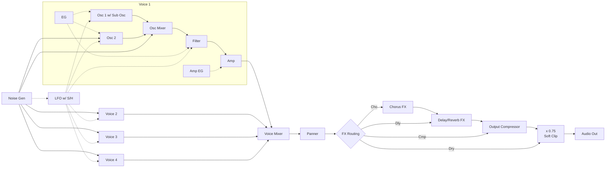

# Digital Synth PRA32-U2 v3.17.1

- 2026-10-24 ISGK Instruments
- <https://github.com/risgk/digital-synth-pra32-u2>
- [日本語版 README (抄訳)](./README.ja.md)

## Overview

- **PRA32-U2** is a 4-Voice Polyphonic Synthesizer for Raspberry Pi Pico 2/RP2350
    - Built-in Chorus and Delay/Reverb FX, followed by the Output Compressor (which also works as the limiter)
    - Controlled by MIDI -- PRA32-U2 is a MIDI sound module
    - Can write the parameters to the user programs and the flash
    - PRA32-U2 started as the successor to PRA32-U (for Raspberry Pi Pico/RP2040), and has since become a different synthesizer
- An **I2S DAC** hardware (e.g. Pimoroni Pico Audio Pack) is required
    - A case for Pico Audio Pack (3D printing data): [Pico Audio Pack Case by YuuichiAkagawa](https://www.thingiverse.com/thing:6404203) (Thingiverse)
- Prebuilt UF2 files (in the "bin" folder): Arduino IDE is not required to use PRA32-U2 without modification
    - Connect Raspberry Pi Pico 2 to a PC while pressing the BOOTSEL button, and copy a UF2 file to the "RP2350" drive
    - PRA32-U2/M (Recommended): "Digital-Synth-PRA32-U2-M-Pimoroni-Pico-Audio-Pack.uf2" is for Raspberry Pi Pico 2 and Pimoroni Pico Audio Pack
        - A superset of PRA32-U2: the Main Synth (Basic Channel + 0) works the same as PRA32-U2, and the Sub Synths and Layering are added
        - NOTE: It also responds to MIDI Channels 2-4 and 14-16 (by default); use PRA32-U2 if these channels are used for other devices
    - PRA32-U2: "Digital-Synth-PRA32-U2-Pimoroni-Pico-Audio-Pack.uf2" is for Raspberry Pi Pico 2 and Pimoroni Pico Audio Pack
- Modifiable with Arduino IDE and Arduino-Pico (by Earle F. Philhower, III): see [Modification Guide](./PRA32-U2-Modification-Guide.md) (e.g. for other I2S DACs, PWM Audio, or the panel)
- Optional
    - **[PRA32-U2/M](#pra32-u2m-pra32-u2-multi-timbre-edition-optional)** (PRA32-U2 Multi-Timbre Edition) can also be configured
    - **[PRA32-U2/P](./README-PRA32-U2-P.md)** (PRA32-U2 with Panel) and **PRA32-U2/M/P** (PRA32-U2 Multi-Timbre Edition with Panel) can also be configured by adding certain parts
- **[PRA32-U2 Native](./PRA32-U2-Native/README.md)**: a software synthesizer (VST3 plugin and standalone application) version of PRA32-U2 for PCs
- **[PRA32-U2 Web](./PRA32-U2-Web/README.md)**: a software synthesizer version of PRA32-U2 that runs in a Web browser, built into PRA32-U2 Editor

## Getting Started

1. Plug Raspberry Pi Pico 2 H into Pico Audio Pack, and connect the line output of Pico Audio Pack to an amplifier or an active speaker
2. Copy a UF2 file to Raspberry Pi Pico 2 (see the prebuilt UF2 files above)
3. Connect it to a PC by USB: it appears as a USB MIDI device "PRA32-U2" ("PRA32-U2/M" for PRA32-U2/M)
4. Open [PRA32-U2 Editor](#pra32-u2-editor) in Google Chrome or Microsoft Edge, select "PRA32-U2" in "MIDI Out", and play the Software Keyboard (MIDI Channel 1)

## [Change History](./PRA32-U2-Change-History.md)

## [Parameter Guide](./PRA32-U2-Parameter-Guide.md)

- See [Main Parameters](./PRA32-U2-Parameter-Guide.md#main-parameters) first: the main parameters, and the Preset to start from

## [MIDI Implementation Chart](./PRA32-U2-MIDI-Implementation-Chart.md)

## Synthesizer Block Diagram

## [Block Diagrams and Wave Table Graphs](./PRA32-U2-Block-Diagrams.md)

- The diagrams of the Osc, the Filter, the Chorus FX, the Delay FX, the Reverb, the Output Compressor, and PRA32-U2/M, and the graphs of the Wave Tables

## [Modification Guide](./PRA32-U2-Modification-Guide.md)

- Preparation for Modification (Arduino IDE, Arduino-Pico, and MIDI Library)
- MIDI (USB MIDI Device and UART MIDI) and Audio Output (I2S, Audio Buffer and latency, and PWM Audio) settings
- Simple Circuit for PWM Audio

## [Development](./PRA32-U2-Development.md)

- Notes for changing the code: Debug Print, how it runs on the two cores, keeping the processing time the same (e.g. branchless), the Load Estimate, writing to the flash, and the tools

## Files

- "Digital-Synth-PRA32-U2.ino" is an Arduino sketch for Raspberry Pi Pico/RP2040/RP2350 core
    - Modify `PRA32_U2_MIDI_CH` to change the MIDI Channel (0-based: 0 is MIDI Channel 1)
- "pra32-u2-make-sample-wav-file.cc" is for debugging on PC
    - GCC (g++) for PC is required
    - "pra32-u2-make-sample-wav-file-cc.bat" makes a sample WAV file (working on Windows)
- "pra32-u2-generate-*.rb" generates source or header files
    - A Ruby execution environment is required

## PRA32-U2 Editor

- "pra32-u2-editor.html": Editor (MIDI Controller) Application for PRA32-U2, HTML App (Web App)
    - Select the MIDI Channel in "MIDI Ch" (1 by default, `PRA32_U2_MIDI_CH`)
- We recommend using Google Chrome or Microsoft Edge, which implement Web MIDI API
    - Refer to "Web browsers" in [PRA32-U2 Web](./PRA32-U2-Web/README.md) for the other Web browsers (e.g. Safari)
    - Safari (Mac, iPhone, iPad) and all the Web browsers on iPhone and iPad do not support Web MIDI API,
      so PRA32-U2 Editor can be used only with PRA32-U2 Web (Built-in), not with PRA32-U2 or other MIDI devices
- Select "PRA32-U2" (or "PRA32-U2/M", etc.) in the list "MIDI Out"
    - Select "PRA32-U2 Web (Built-in)" to use [PRA32-U2 Web](./PRA32-U2-Web/README.md), without PRA32-U2
- Functions
    - Program Changes via PRA32-U2 Editor (from "MIDI In" on the MIDI Ch of the Editor) are not passed to PRA32-U2:
      PRA32-U2 Editor recalls the preset instead, and sends its parameters as Control Changes
        - #0-15: the user presets of PRA32-U2 Editor (stored in the Web browser), not the programs #0-15 of PRA32-U2 (written by Write)
        - #16-31: the factory presets (the same as the programs #16-31 of PRA32-U2)
        - To select the programs of PRA32-U2 itself, send Program Changes to PRA32-U2 directly (without PRA32-U2 Editor),
          or use the Program Change buttons (in "Save & Load")
    - When Program Change #127 is entered or Control Change #111 is changed from Off (63 or lower) to On (64 or higher), "Randomize Synth" is processed
    - PRA32-U2 Editor stores the current control values and the user presets (#0-15) in a Web browser (localStorage)
    - Current parameter values and user presets (#0-15) can be imported/exported from/to JSON files
    - User presets: a name of up to 10 ASCII letters, digits, and symbols can be given by Store (shown on the User Preset buttons)
    - Undo: back to the parameters before the last change (a preset, Randomize, Import, or a move of a slider), up to 200 steps; Redo: forward again (also by Ctrl+Z and Ctrl+Y or Ctrl+Shift+Z, or Command on a Mac)
    - "MIDI" and "Actions & Presets" (with "Save & Load" under it) can each be hidden, to give the parameters more of the window
    - The controls look the same in every Web browser and OS (as in Chrome); on a touch screen, the thumbs of the sliders are larger, and the buttons taller
    - Software Keyboard
        - Below the parameters, it stays at the bottom of the window while they scroll above it, so that they can be changed while playing; it can be hidden (Panic stays shown; hiding turns Hold off)
        - While Hold is on, the keys released keep their notes on (turning Hold off, or Panic, turns them off)
        - The PC keyboard can also be played while it is shown (A - K for C - C, W - U for the black keys, and Z / X for the octave);
          some PC keyboards cannot take many keys at the same time (e.g. a chord of 4 notes)
        - The velocities of Note On and Note Off can be entered (1-127, 100 and 64 by default)
        - Pitch Bend (springs back to the center), Modulation Wheel, Breath Controller, Expression, Sustain Pedal, Portamento Switch,
          and Channel Pressure can be sent from the sliders below the keyboard (Performance Controls, which can be hidden apart from the keyboard,
          e.g. on a phone)
- When not using PRA32-U2 Editor (e.g. with a DAW or a MIDI keyboard)
    - PRA32-U2 can also be controlled by MIDI without using PRA32-U2 Editor
    - Sounds made with PRA32-U2 Editor can be written to PRA32-U2, and recalled later without PRA32-U2 Editor
        1. Write: press a Write button (#0-15, in "Save & Load") of PRA32-U2 Editor, to write the current parameters
           to the program of PRA32-U2 (also to the flash, so that they are kept after the power is turned off);
           the parameters shown in PRA32-U2 Editor are sent again before writing
        2. Send Program Change #0-15 to PRA32-U2 directly (not via PRA32-U2 Editor) to recall the program
    - The Program Change buttons (in "Save & Load") of PRA32-U2 Editor also send Program Changes to PRA32-U2 directly
      (NOTE: The parameters shown in PRA32-U2 Editor are not updated)
    - The default program (when the power is turned on) is #0
    - "Randomize Synth" is also processed by PRA32-U2 itself (Program Change #127 or Control Change #111 from Off to On)
    - Refer to [PRA32-U2-MIDI-Implementation-Chart.md](./PRA32-U2-MIDI-Implementation-Chart.md) for the supported functions
    - Programs #0-31 can be modified by editing "pra32-u2-program-table.h"

## PRA32-U2/M (PRA32-U2 Multi-Timbre Edition) (Optional)

- Features
    - Synths
        - Basic Channel + 0 (Default 1): Main Synth, Poly or Mono; The default program is #0; The FX parameters (except FX Routing) apply to all channels
        - Basic Channel + 1 (Default 2): Sub Synth 1, Mono; The default program is #1; The FX parameters (except FX Routing) are disabled
        - Basic Channel + 2 (Default 3): Sub Synth 2, Mono; The default program is #2; The FX parameters (except FX Routing) are disabled
        - Basic Channel + 3 (Default 4): Sub Synth 3, Mono; The default program is #3; The FX parameters (except FX Routing) are disabled
        - *Basic Channels + 1 to + 3 (Sub Synths) are processed only if Basic Channel + 0 (Main Synth) is in Mono modes*
    - Layering
        - Basic Channel - 3 (Default 14): Control Basic Channel + 0 and + 1 simultaneously
            - Results of Program Change: Program # + 0 for Basic Channel + 0 and Program # + 1 for Basic Channel + 1
        - Basic Channel - 2 (Default 15): Control Basic Channel + 2 and + 3 simultaneously
            - Results of Program Change: Program # + 0 for Basic Channel + 2 and Program # + 1 for Basic Channel + 3
        - Basic Channel - 1 (Default 16): Control Basic Channel + 0, + 1, + 2, and + 3 simultaneously
            - Results of Program Change: Program # + 0 for Basic Channel + 0, Program # + 1 for Basic Channel + 1, Program # + 2 for Basic Channel + 2, and Program # + 3 for Basic Channel + 3
        - Not to use this feature, comment out `#define PRA32_U2_ENABLE_LAYERING` in "Digital-Synth-PRA32-U2-M.ino"
- How to modify
    - Copy all files in the "Digital-Synth-PRA32-U2" folder, except for "Digital-Synth-PRA32-U2.ino", to the "Digital-Synth-PRA32-U2-M" folder
    - "Digital-Synth-PRA32-U2-M.ino" is an Arduino sketch

## [PRA32-U2/P](./README-PRA32-U2-P.md) (PRA32-U2 with Panel) (Optional)

## [PRA32-U2 Native](./PRA32-U2-Native/README.md)

## [PRA32-U2 Web](./PRA32-U2-Web/README.md)

## Customization Examples

- Files in the "customization-examples" folder
- **Digital Synth PRA32-U2 (Lite)**
    - Osc 1 Shape and Morph are disabled in Saw, Sqr, and WT
    - Runs on a single core
    - "Digital-Synth-PRA32-U2.ino.Lite-Core-0-Only.txt"
    - "Digital-Synth-PRA32-U2.ino.Lite-Core-1-Only.txt"
- **Digital Synth PRA32-U2/M (Lite)**
    - Osc 1 Shape and Morph are disabled in Saw, Sqr, and WT
    - Runs on a single core
    - "Digital-Synth-PRA32-U2-M.ino.Lite-Core-0-Only.txt"
    - "Digital-Synth-PRA32-U2-M.ino.Lite-Core-1-Only.txt"

## Troubleshooting

- The "RP2350" drive does not appear
    - Use a USB cable that supports data transfer (not a charge-only cable)
    - Keep pressing the BOOTSEL button while connecting the USB cable, and release it after connecting
- "PRA32-U2" (or "PRA32-U2/M", etc.) does not appear in the list "MIDI Out" of PRA32-U2 Editor
    - Use Google Chrome or Microsoft Edge, and allow access to MIDI devices
    - PRA32-U2 Editor makes the list of MIDI ports when it is opened; reload the page if PRA32-U2 is connected after opening PRA32-U2 Editor
- No sound
    - Check the wiring of the I2S DAC (for GY-PCM5102, also check that SCK is connected to GND, and the solder jumpers on the back)
    - Check that "MIDI Ch" of PRA32-U2 Editor matches the MIDI Channel of PRA32-U2 (1 by default)
- Noise
    - The output may be affected by USB communication noise; try [UART MIDI](./PRA32-U2-Modification-Guide.md#uart-midi)
    - With PWM Audio without the RC filters, reduce the level: see [PWM Audio (Optional)](./PRA32-U2-Modification-Guide.md#pwm-audio-optional)
- Distortion
    - Lower "Amp Gain" (a high Filter Resonance or a high Osc 1 Shape/Morph makes the sound louder)
    - With FX Routing Dry, the output does not go through the Output Compressor, and loud sounds are distorted by the soft clipping; choose another FX Routing (e.g. Cmp)
- No portamento
    - Check that Portamento Time is not 0
    - Check that Portamento Mode is Aut, or that Portamento Switch (Control Change #65) is On if Portamento Mode is Sw
    - In Legato Portamento (Voice Mode: LP), the Portamento is effective only for the legato notes
    - In the Polyphonic Mode, the Portamento is effective only when Voice Assign Mode is 2 or 4

## License

**Digital Synth PRA32-U2 v3.17.1 by ISGK Instruments (Ryo Ishigaki)**

To the extent possible under law, ISGK Instruments (Ryo Ishigaki)
has waived all copyright and related or neighboring rights
to Digital Synth PRA32-U2 v3.17.1.

You should have received a copy of the CC0 legalcode along with this
work.  If not, see <http://creativecommons.org/publicdomain/zero/1.0/>.

### For Your Information

If PRA32-U2 is to be embedded in instruments or others, it would be nice
(but not required) to display the following:

- Powered by ISGK Instruments PRA32-U2
- Powered by PRA32-U2
